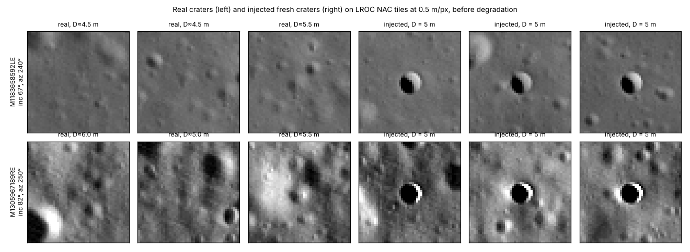
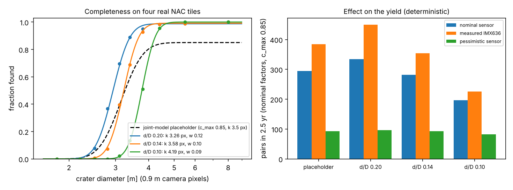

> This note reports the first run of the [crater-injection test kit](../../analysis/crater_injection_test/README.md) on real Lunar Reconnaissance Orbiter (LRO) Narrow Angle Camera (NAC) images. It tests the proposal's assumed crater-confirmation curve and diameter error (joint model, S14). The full test with real new craters and before/after image pairs still needs the NAC archive, which neither our analysis environment nor the linked computer can reach; the team can run it locally. Data are in `data/crater_injection_test/`, figures in `figures/crater_injection_test/` and the run scripts in the kit's `real_tiles/` folder.

# 1. Summary

We injected 1,800 synthetic fresh craters of 1.8–8 m into four real NAC image tiles, degraded them to the TriScape200 crater camera at 300 km, and searched for them with the kit's automated before/after comparison. The result depends mainly on how deep small fresh craters are. For the central depth-to-diameter ratio of 0.14 (Stopar et al. 2017 measured 0.11–0.17 for very fresh craters below 400 m), half of the craters are found at **3.2 m (3.58 camera pixels)**. The proposal assumes 3.15 m (3.5 pixels). The transition is sharper than assumed (width 0.10 instead of 0.15 in ln D). Across the depth range of 0.10–0.20 the 50% point moves from 2.9 m to 3.8 m.

At nominal factors, the measured central curve changes the Option A yield by −4% for the nominal sensor (282 against 294 pairs), by −8% for the measured IMX636 (354 against 384) and by 0% for the pessimistic sensor (93). The joint model's Monte Carlo already varies the size limit between 3 and 5 pixels, so the proposal's yield ranges include this result. **The confirmation placeholder holds on real terrain. It should not be replaced yet,** because two effects were not tested: the plateau (the proposal assumes at most 85%) and real before/after differences. Diameters are measured with a scatter of about 0.5 pixels divided by the crater size in pixels, somewhat worse than the assumed 0.35, and a +3% bias.

# 2. Data and method

**Images.** The tiles come from the public CraterDANet crater dataset (Yang et al., IEEE TGRS; GPL-3.0), which contains calibrated NAC images near the Chang'e-4 landing site at about 45°S, 177°E, resampled to 0.5 m per pixel. Of its eight test tiles we use the four whose source images have native pixels of 0.60–0.84 m (Table 1). The other four are coarser than our 0.9 m camera (1.15–1.39 m) or strongly oblique, so they cannot represent its images. Each tile covers 0.5 × 0.5 km.

Table: Real NAC tiles used. Incidence and native resolution from the LROC observation pages. The Sun azimuth in tile coordinates was fitted to the dataset's labelled craters; the correlation with the opposite direction shows that the fit is unambiguous.

| Source image | Sun incidence | Native pixel | Signal per pixel | Sun azimuth (fit) | Fit correlation (opposite) |
|---|---|---|---|---|---|
| M1305967189R | 81.7° | 0.84 m | 100 e⁻ | 250° | +0.14 (−0.14) |
| M1183658592L | 67.5° | 0.74 m | 270 e⁻ | 240° | +0.30 (−0.31) |
| M1229577647L | 65.9° | 0.60 m | 290 e⁻ | 300° | +0.28 (−0.30) |
| M1303619844L | 62.6° | 0.84 m | 330 e⁻ | 240° | +0.29 (−0.29) |

**Test.** For each tile and each of ten diameters, 45 craters were rendered with the tile's Sun geometry: a bowl with a raised rim, cast shadows and a bright ejecta halo. The tile was degraded twice, once with the craters and once without, to the crater camera:

- pixel integration to 0.9 m;
- a 0.6-pixel blur;
- shot and read noise;
- the camera's RGB Bayer sampling.

The signal per pixel follows the proposal's 300 electrons at 65° incidence and scales with the cosine of the incidence for the same 0.34 ms exposure. A matched filter compared the two images, with its threshold set for 0.01 false candidates per km², about 0.05 per flash error region. Three crater shapes were tested: depth/diameter 0.20 (rim 0.04 D, halo +10%), 0.14 (0.028 D, +7.5%) and 0.10 (0.02 D, +5%).

**Visual check.** The injected craters shade in the same direction as the real craters of the tiles (Figure 1). They are crisper than the tiles' real craters of the same size, which are old and degraded. That difference is expected for fresh craters, but it is the reason for testing several depths.

# 3. Results

Table: Pooled confirmation curve and diameter error (four tiles; two tiles for depth 0.10). The values replace c(D) = c_max · Φ((ln D − ln(k · 0.9 m)) / w) and sd(ln D) = b / D_px of the joint model.

| Crater shape | k (50% point) | 50% diameter | Width w | c_max (upper bound) | Diameter error b | Diameter bias |
|---|---|---|---|---|---|---|
| Joint-model placeholder | 3.5 px | 3.15 m | 0.15 | 0.85 | 0.35 px | 0 |
| depth/D 0.20 | 3.26 px (3.23–3.27) | 2.9 m | 0.12 | 0.99 | 0.48 px | +3% |
| **depth/D 0.14 (central)** | **3.58 px (3.56–3.60)** | **3.2 m** | **0.10** | **0.99** | **0.46 px** | **+3%** |
| depth/D 0.10 | 4.19 px | 3.8 m | 0.09 | 1.00 | 0.48 px | +2% |

The tiles differ less than the crater shapes do. For the central shape the 50% point ranges from 3.4 pixels (67.5° incidence) to 3.7 pixels (81.7°, where shadows hide part of the terrain and the signal is only a third). The large craters were missed only on the low-Sun tile (97% plateau).

Table: Option A pairs in 2.5 years at nominal factors (deterministic), with c_max kept at 0.85.

| Sensor | Placeholder | depth/D 0.20 | depth/D 0.14 | depth/D 0.10 |
|---|---|---|---|---|
| Nominal (revision 5) | 294 | 334 | 282 | 197 |
| Measured IMX636 (sensor trade) | 384 | 450 | 354 | 225 |
| Pessimistic (revision 5) | 93 | 96 | 93 | 82 |

The pessimistic sensor barely depends on the crater curve, because its yield is limited by flash detection.

# 4. What this test does not cover

- **Real before/after differences.** "Before" and "after" were the same tile apart from noise. Registration errors, differences in lighting and resolution between the LRO archive image and the TriScape200 image, and real surface changes are therefore not included. The measured plateau (c_max ≈ 0.99) and the false-alarm rate are upper bounds; the proposal's c_max of 0.85 stays.
- **Sun angle.** Only incidences of 62–82° were available, the upper end of the normal imaging mode (20–70°). At lower incidence the shadows are shorter and small craters are harder to see, so the curve probably moves to larger craters there.
- **Terrain.** One region (the floor of Von Kármán crater) and 1 km² of terrain in total. The tiles were resampled from 0.60–0.84 m native pixels, slightly smoother than true 0.9 m images.
- **Crater model.** Real fresh craters vary in depth, rim and halo; some have no bright halo.
- **Automated detection.** The matched filter knows the Sun direction. A human reviewer, who will actually confirm the pairs, may do better or worse.

The decisive remaining test is the **real new craters**: LROC's published new-crater catalogue lists craters that formed during the LRO mission, with matched before/after NAC images and measured diameters (Speyerer et al. 2016). Degrading those real pairs to our camera tests all of the above at once. It needs the NAC archive, so the team runs it locally with the kit (`real` mode), together with the blind human review.

# References

- Speyerer E. J. et al. (2016), *Quantifying crater production and regolith overturn on the Moon with temporal imaging*, Nature 538, 215–218. New-crater catalogue: [LROC new-craters shapefile](https://data.lroc.im-ldi.com/lroc/view_rdr/SHAPEFILE_GLOBAL_NEW_CRATERS)
- Stopar J. D. et al. (2017), *Relative depths of simple craters and the nature of the lunar regolith*, Icarus 298, 34–48. [doi:10.1016/j.icarus.2017.05.022](https://doi.org/10.1016/j.icarus.2017.05.022)
- Yang H. et al., *CraterDANet: a convolutional neural network for small-scale crater detection via synthetic-to-real domain adaptation*, IEEE TGRS; dataset: [Lunar_Crater_Detection_Data](https://github.com/yizuifangxiuyh/Lunar_Crater_Detection_Data)
- LROC observation pages for the four source images (incidence, resolution), for example [M1305967189R](https://data.lroc.im-ldi.com/lroc/view_lroc/LRO-L-LROC-2-EDR-V1.0/M1305967189RE)
- Simera Sense TriScape200 specifications (3.2 µm pixels, 1067 mm focal length, RGB Bayer): [satnow.com](https://satnow.com/products/satellite-cameras/simera-sense/113-1295-triscape200)
