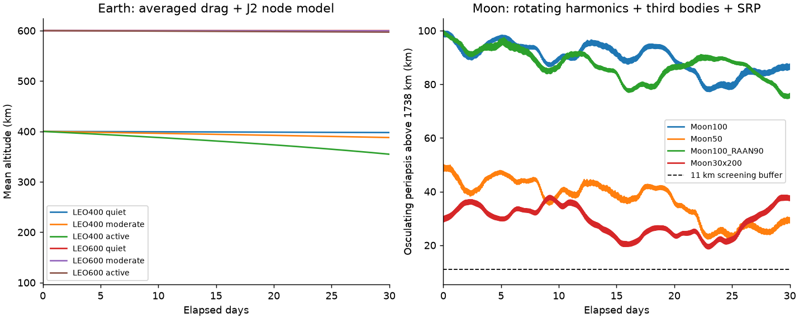
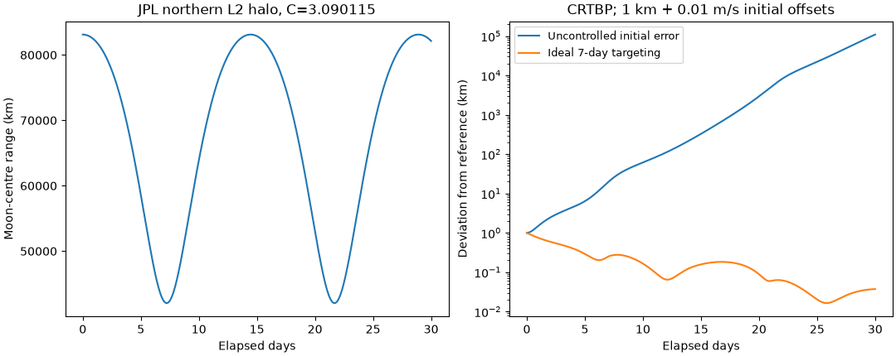
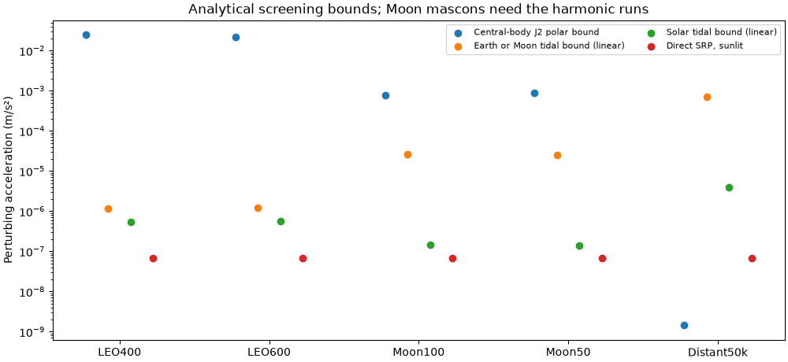
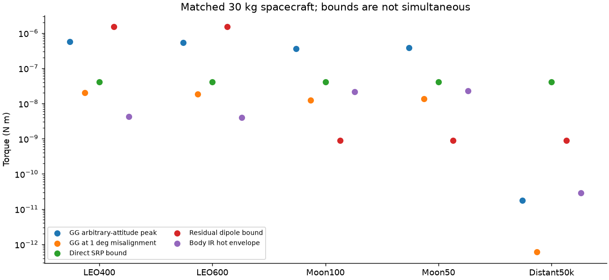
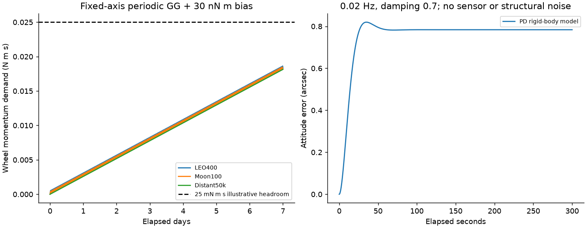

# Orbital and attitude disturbance environment

Prepared **29 October 2026**. Quantitative supporting study for SMD concept/SRR work. **No orbit, spacecraft size, component, control allocation or numerical D requirement is approved by this note.**

## Findings that change the design

1. **Low lunar orbits usually become unsafe through changes in eccentricity/periapsis, rather than Earth-like drag decay.** The 100 km polar fixture reaches an osculating periapsis of **77.3 km** in 30 days; its sampled semimajor axis spans only **1.79 km**. The 50 km fixture crosses the assumed **11 km radial screening buffer at 48.2 days**. This is not a terrain-impact prediction or a universal lunar lifetime.
2. **Geometry can save more propellant than a small change in bus technology.** LRO flight operations report about **143 m/s/year** in the tightly maintained 50 km science orbit and **less than 5 m/s/year** after transition to frozen geometry. Those are different envelopes, not interchangeable maintenance rates. [DE05](https://ntrs.nasa.gov/api/citations/20230010952/downloads/Mesarch_LROLongTermOrbit_Preprint_20230727.pdf)
3. **Lunar gravity-gradient torque remains comparable to LEO.** At 100 km it is **61.7%** of the 400 km LEO value for the same inertia and attitude. Lunar magnetic torque is much smaller in the declared field scenarios, so a familiar LEO magnetic unloading strategy loses authority.
4. **Distant observation reduces central lunar gravity-gradient torque by roughly four orders of magnitude**, while direct solar pressure is almost unchanged. The reference halo spans **42,056–83,121 km** from the Moon and is dynamically unstable. Distant location does not remove maintenance, navigation, range-dependent sensitivity or whole-surface coverage requirements.
5. **Wheel storage, geometry and jitter evidence matter more than environmental wheel torque capability in this fixture.** A 30 nN·m bias fills 0.025 N·m·s in **9.65 days**. Removing it over a year with the assumed balanced 15 cm thruster couple takes **6.31 N·s**, about **8.0 g** of propellant at 80 s Isp. Neither the torque budget nor the illustrative controller establishes the earlier sub-arcsecond pointing allocations.

## 1. Comparison contract

All local physical calculations use SI units internally. Lunar altitudes are above the **1738 km gravity reference sphere**, not the 1737.4 km volumetric mean radius or a local DEM. Earth radii use 6378.137 km. Differences in this convention must be retained when comparing published values.

| Parameter | Matched reference fixture | Status / sensitivity |
| --- | --- | --- |
| Spacecraft mass | 30 kg | Assumption; not a selected platform. Too small for the D01 200 mm illustrative optics and not the 30 Oct 80 kg / 16-head reference; recompute absolute torque, momentum and propellant for a selected spacecraft |
| Uniform box dimensions, x/y/z | 0.20 / 0.30 / 0.40 m | Inertia derived as m(b²+c²)/12; arrays/optics idealized into the fixture |
| Principal inertias, x/y/z | 0.625 / 0.500 / 0.325 kg·m² | Diagonal; ΔI=0.300 kg·m². Real appendages require CAD-derived inertia |
| Projected drag and radiation area | 0.30 m² | Effective area held equal for comparison; 0.10–0.60 m² gives one-third to twice area-driven force/torque |
| Cd / effective Cr | 2.2 / 1.5 | Provisional free-molecular / cannonball optical coefficients; Cr sensitivity1–2 |
| Aerodynamic and photon-pressure moment arm | 0.020 m perpendicular maximum | 0.005–0.10 m gives0.25–5 times torque. Directions and actual plate properties are unresolved |
| Residual magnetic dipole | 0.030 A·m² | Assumption; 0.003–0.30 gives0.1–10 times torque |
| Anisotropic thermal emission | 2 W at0.10 m, collimated upper recoil | Separate from incoming planetary IR; 0–10 W sensitivity |
| Earth magnetic scenario | 50 µT | Tens-of-µT LEO screening fixture, no WMM history [DE16](https://www.ncei.noaa.gov/products/world-magnetic-model) |
| Lunar external/crustal field scenarios | 5 / 30 / 100 nT | Sensitivities, not certified percentiles or a propagated magnetic model; no Earth-like dynamo [DE15](https://doi.org/10.1029/2010JE003650) |
| Thruster couple | Two opposing1 mN forces, each0.15 m from COM | Assumed independently commanded, balanced geometry. Actual module placement remains open |

The lunar epoch is **2026-10-29 00:00:00 UTC**, converted by SPICE to ET/TDB. States propagate in **Moon-centred J2000/ICRF**, with differential Earth/Sun forces. Initial Keplerian elements are referenced to the **epoch lunar PA equator, frozen inertially**; initial Ω=0°,i=90°,e=0,u=0° for circular cases. Ω=90° is the orientation sensitivity. The elliptical case has hp=30 km,ha=200 km,ω=270°,ν=0°,i=90°,Ω=0°. Nonsingular radius/eccentricity metrics drive the conclusions; argument of periapsis is undefined at exact circularity.

Earth fixtures start circular, i=51.6° at400 km and98° at600 km, Ω=u=0 in a simplified equatorial frame at the same UTC epoch. The rounded600 km inclination is **not an exact Sun-synchronous design**. The Earth model evolves mean circular a and J2 node, not a full Cartesian ephemeris; its e stays zero by construction and its uncomputed short-period elements must not be presented as predictions.

The JPL halo is a separate **autonomous circular restricted three-body problem (CRTBP)**, rotating barycentric x toward the Moon and z along Earth–Moon angular momentum. It has no unique calendar realization. Phase zero may be placed at the study epoch for plotting, but this is **not an ephemeris halo at that date**. Its normalized state and system constants are preserved in [distant results](../../analysis/disturbance_environment_research/distant_results.json).

## 2. What “decay” means in these cases

Drag removes mechanical orbital energy. For near-circular Earth motion, da/dt follows the atmospheric drag power; changing density as altitude falls accelerates the loss. J2 and mascons principally change node, apsis and eccentricity. In a rotating gravity field or a multi-body problem, two-body osculating energy can vary without an atmospheric-style sink. A low pericentre, resonance, unstable manifold departure or collision risk is therefore not a universal semimajor-axis decay rate.

At a libration orbit the Moon and Earth jointly define the motion. A Moon-centred Keplerian semimajor axis or an acceleration magnitude integrated over time is an unsuitable stationkeeping estimator. The local halo study instead propagates a reference state, an offset state and an explicit targeting policy.

### Earth LEO: actually executed atmosphere and averaged evolution

NRLMSIS2.0 was run through **pymsis0.13.0**, with96 positions/times over the first nominal orbit, spherical geocentric latitudes, Earth corotation, and a10 km altitude profile grid. F10.7 daily and81-day values are both **70 / 140 / 220 sfu**; daily ap is **4 / 15 / 100**, with the default daily-ap model. These cases are called quiet/moderate/active; holding an active state for a year is a stress fixture, not a predicted storm duration. The first-orbit mean density profile is held fixed in season, local-time distribution and orbital orientation while a changes. Geodetic/spherical differences, winds and actual weather histories are outside this model. [DE07](https://repository.library.noaa.gov/view/noaa/53074)

The drag power uses v_rel=v−ω_E×r, not inertial speed alone. The scalar ODE uses da/dt=−ρ Cd A/m × a²/µ × mean(|v_rel| v·v_rel). It stops at **120 km mean altitude**, where a circular secular drag model is no longer an adequate reentry solution. Reaching that boundary is not a modelled impact. No terminal reentry lifetime is claimed.

| Case / atmosphere | Mean density [kg/m³] | Initial loss [km/day] | Loss at day 30 [km] | Held-altitude drag makeup [m/s/year] | Extended horizon result |
| --- | --- | --- | --- | --- | --- |
| LEO400_quiet | 7.91e-13 | 0.0721 | 2.215 | 14.88 | 360.5 km at 365.0 days |
| LEO400_moderate | 4.01e-12 | 0.3654 | 12.126 | 75.45 | 120.0 km at 148.2 days |
| LEO400_active | 1.22e-11 | 1.1109 | 45.237 | 229.37 | 120.0 km at 57.1 days |
| LEO600_quiet | 2.03e-14 | 0.0021 | 0.062 | 0.41 | 599.2 km at 365.0 days |
| LEO600_moderate | 1.92e-13 | 0.0196 | 0.591 | 3.88 | 592.5 km at 365.0 days |
| LEO600_active | 9.5e-13 | 0.0971 | 2.962 | 19.20 | 554.6 km at 365.0 days |

The model gives J2 node rates **−5.002°/day** and **+1.012°/day** at the initial400/600 km radii. They are precession, not altitude decay; the98° fixture would need refinement to match the solar apparent motion. For a small5 km allowed drop, initial-rate trigger cadences are approximately **69/14/4.5 days at400 km**, and **2413/255/51 days at600 km**. A held-altitude compensation policy continuously replaces the computed drag power; the annual costs in the table belong to that ideal maintained case, not to uncontrolled falling altitude. Discrete burn targeting, thrust duty and density forecast error require a subsequent design.

### Low lunar orbit: actual rotating-harmonic propagation

The force model includes **GRGM1200A truncated at80×80**, with40×40 and120×120 checks; fully normalized4π coefficients, no Condon–Shortley phase; point-mass central gravity; geometric DE440s Earth/Sun vectors; direct cannonball SRP; and an instantaneous cylindrical lunar shadow. DOP853 uses relative tolerance2×10⁻⁹, absolute tolerance10⁻⁵ on SI state components and maximum step 120 s. Outputs are sampled at 600 s, and force norms at1h. Earth/Sun vectors are cubic-interpolated from1h SPICE samples. No tides, Earth shadow/penumbra, planetary radiation, drag, gravity clones, navigation/control or DEM are propagated. Their importance is bounded or left explicit below.

GRGM1200A specifies **DE430 PA**; the available binary orientation is **DE421 PA**. This is an approximation, not a claim that the frames are identical. A0.01° gravity-orientation offset is tested. The model uses the label GM; the archived coefficient header differs by1.5ppb, far smaller than other limits. Exact-frame/tidal/terrain reconstruction is required for operational orbit certification. [DE01](https://pds-geosciences.wustl.edu/grail/grail-l-lgrs-5-rdr-v1/grail_1001/shadr/gggrx_1200a_sha.lbl), [DE03](https://naif.jpl.nasa.gov/pub/naif/generic_kernels/fk/satellites/moon_080317.tf)

| Initial case, degree/order 80 | Day-30 hp / ha [km] | Minimum osculating hp [km] | Sampled a range [km] | Interval / stop |
| --- | --- | --- | --- | --- |
| Moon100_N80 | 85.61 / 112.37 | 77.31 | 1836.56–1838.34 | 30.0 days |
| Moon50_N80 | 29.22 / 68.96 | 9.84 | 1786.44–1788.51 | 48.2 days / 11 km radial buffer |
| Moon100_RAAN90_N80 | 75.72 / 123.82 | 74.72 | 1836.80–1838.59 | 30.0 days |
| Moon30x200_N80 | 37.53 / 193.54 | 18.66 | 1852.57–1854.48 | 30.0 days |

For the50 km case the minimum-hp column covers the full48-day run; the other cases cover30 days. Osculating hp is not the spacecraft's current radius, and can fall below the screening boundary before an actual radial crossing. The50 km integration terminates when **|r|=1738+11 km** on a descending passage. The assumed11 km buffer is a screening choice, **not a validated terrain-clearance envelope or local impact**. The48.2-day boundary time was computed at degree80; degree120 was checked to30 days only, so a converged time-to-boundary is unresolved.

The100 km Ω=90° fixture has minimum hp=74.7 km versus77.3 km atΩ=0°. These two phases do not bound every launch date/orientation. The30×200 km fixture yields hp≈18.7–38.6 km in this30-day run, but it is **not an optimized frozen orbit or one-year survival certificate**. It is a useful geometry comparator to the LRO quasi-frozen examples.

### Published maintained/uncontrolled low-lunar cases

LRO provides the stronger long-duration operational comparison: the50±15 km science envelope used paired apsis-rotation burns approximately every28 days, about 11 m/s per cycle; extended frozen geometries used much less maintenance. The2007 design examples reach a **12 km mountain screening envelope in about41 days at50 km and150 days at100 km**, under their initial geometry and older force model. Those values differ from this study's initial state and boundary. Do not fit a universal km/day decay rate to either set. LRO later allowed apses to drift rather than holding the tight early science envelope. [DE05](https://ntrs.nasa.gov/api/citations/20230010952/downloads/Mesarch_LROLongTermOrbit_Preprint_20230727.pdf), [DE06](https://ntrs.nasa.gov/api/citations/20070035736/downloads/20070035736.pdf)

LRO reports an observed inclination trend around0.4°/year and an estimated 14 m/s/year to suppress it. Its flight stationkeeping execution averaged 2.7 cm/s magnitude error (about0.5%), with individual errors within 12 cm/s in the reported set; these are flight comparator conditions, not assumptions established for a new small spacecraft. Navigation covariance and burn-error margins remain to be selected for SMD. Coverage must tolerate or control plane evolution explicitly. Neither the100 km30-day survival nor the published frozen comparator establishes this mission's polar exposure or one-year clearance.

### Distant observer: a defined and actually propagated halo

The JPL catalogue query returns multiple branches. The script selects a **long-period northern L2 halo** nearest C=3.09, with C=3.090115115919. Normalization is L=389,703.264829 km and TU=382981.289129 s, mass ratio=0.01215058560962. Initial state [x,y,z,vx,vy,vz] is approximately **[1.1589028132,0,0.1274150464,0,−0.2099714489,0]**. The exact numbers are retained in JSON. This is a nearby family comparator, not LUMIO's operational state. [DE08](https://ssd-api.jpl.nasa.gov/doc/periodic_orbits.html)

| Quantity | Actual CRTBP result |
| --- | --- |
| Period | 14.4554 days |
| Moon-centre range over30 days | 42,056–83,121 km |
| Out-of-plane amplitude | 49,654 km |
| Initial error | +1 km x and+0.01 m/s vy; remaining offsets zero |
| Uncontrolled deviation from reference at30 days | 109,583 km |
| Unstable multiplier / local e-folding time | 340.8 per period / 2.48 days |
| Ideal7-day correction result | ≤1.00 km deviation over30 days; total 0.0162 m/s |

The ideal controller targets reference **position14 days downstream**, applying velocity impulses every7 days with exact navigation/execution. It corrects only the initial error; it does not include continuous Sun/SRP/model errors or stochastic navigation errors. Its small correction cost **must not be annualized as stationkeeping demand**. The large uncontrolled departure is a nonlinear trajectory deviation, not a safe lunar-altitude loss rate or a certified escape.

For actual resource screening, the2024 LUMIO design gives annual mean **8.256 m/s**,3σ **15.79 m/s**, with a2-day planning cut-off; an earlier2018 study gives 28.1 m/s at3σ under different assumptions. Retaining **16–30 m/s/year as a provisional L2 sensitivity** (a bracket spanning two dated studies with different assumptions) is defensible until an epoch/navigation/control design is selected. Earlier2022 results of1.86/4.34 m/s were more optimistic; they should not silently replace the later result. The2026 transfer paper still uses Cj=3.09, while ESA reports Phase C and a possible2028 launch. These are design/schedule evidence, not flight performance. [DE09](https://re.public.polimi.it/bitstream/11311/1266785/1/TOPPF01-24.pdf), [DE10](https://re.public.polimi.it/bitstream/11311/1215727/1/FRANV02-22.pdf), [DE11](https://doi.org/10.3389/fspas.2018.00029), [DE12](https://doi.org/10.1007/s40295-026-00639-2), [DE13](https://www.esa.int/Enabling_Support/Space_Engineering_Technology/Shaping_the_Future/A_leap_forward_for_Lumio_Phase_C_officially_launched)

The2.48-day e-folding time is a local linear descriptor. Missing a7-day correction can grow an unstable-mode error by roughly exp(7/2.48)≈17 locally; phase and mode projection matter. Propagate a missed-burn case before setting a real recovery deadline. The ideal example cannot prove recovery after a navigation outage.

## 3. Force budget and neglected effects

Use vector differential third-body acceleration µ[(R−r)/|R−r|³−R/|R|³]. The following screening bounds are not simultaneous forces. At50,000 km, the exact anti-Earth differential acceleration is preferable to the linear tidal approximation.

| Mechanism [m/s²] |400 km LEO|100 km lunar|50,000 km Moon-centre example|Meaning / fidelity|
|---|---|---|---|---|
|Central gravity|8.68|1.45|1.96×10⁻³|Main acceleration, not a disturbance budget or maintenance demand|
|Non-spherical central gravity|J2 polar bound2.50×10⁻²|Actual80-degree norm RMS7.19×10⁻⁴; sampled max1.96×10⁻³|J2 bound≈1.4×10⁻⁹|Earth J2 analytic; lunar lifetime uses harmonics, not J2|
|Earth or Moon third body|Moon linear maximum1.17×10⁻⁶|Earth actual RMS1.79×10⁻⁵; sampled max3.12×10⁻⁵|Exact anti-Earth differential≈5.85×10⁻⁴|At distant orbit use full multi-body equations|
|Solar third body|Linear maximum5.37×10⁻⁷|Actual RMS1.13×10⁻⁷|Linear maximum3.96×10⁻⁶|Geometry-dependent conservative tide|
|Direct SRP|Sunlit6.81×10⁻⁸|Sunlit6.81×10⁻⁸; actual shadowed RMS5.43×10⁻⁸|Sunlit6.81×10⁻⁸|A/m=0.01 m²/kg,Cr1.5,1AU; optical/area sensitivity|
|Earth atmospheric drag|Equivalent initial tangential≈4.7×10⁻⁷–7.3×10⁻⁶|Not an Earth atmosphere|Not an Earth atmosphere|Quiet-to-active 400 km range; see density table|
|Lunar ambient-exosphere screen|Not applicable|≤3.90×10⁻¹⁰ under the specified density screen|No orbit-wide density assumed|Screen below; no claimed exact zero|
|2 W anisotropic thermal beam|2.22×10⁻¹⁰|2.22×10⁻¹⁰|2.22×10⁻¹⁰|Spacecraft-generated, geometry/time dependent|

The distant Earth number above is rounded; [the machine-readable bounds](../../data/disturbance_environment/analytical_bounds.json) preserve the exact evaluated value. SRP shadow transitions, orientation and eclipse season must be modelled in a maintained ephemeris trajectory. Incoming reflected/IR forces equal the torque estimates below divided by the assumed 2 cm arm and mass; they are below the dominant close-lunar gravity perturbations, but can matter for precise orbit determination. Tides and higher harmonics may shift longer-term clearance and are not certified negligible by a30-day run.

For an intentionally conservative **ambient-exosphere screen**, carry the surface upper estimate2×10⁵particles/cm³ to 100 km unchanged and assign every atom40u. This givesρ=1.33×10⁻¹⁴kg/m³ and only about **2.3m equivalent semimajor-axis loss over30 days**, under the circular, stationary-gas screen. It is not an altitude profile, excludes transient plumes/outgassing, and is not a bound on the operational gas environment of nearby landers. Its small nominal scale explains why mascon-driven periapsis evolution dominates the low-lunar case. [DE14](https://nssdc.gsfc.nasa.gov/planetary/factsheet/moonfact.html)

Other effects are screened conditionally, rather than declared absent:

- Solar wind fixture n=5 cm⁻³,v=400 km/s gives dynamic pressure1.34nPa and absorbing torque8×10⁻¹²N·m for 0.30 m²/2 cm. Even a100×pressure sensitivity stays below direct SRP torque; this is not a solar-event percentile.
- A0.30m isolated-sphere capacitance at1000V gives charge3.34×10⁻⁸C. qvB is about1.3×10⁻⁸N in the 7700 m/s,50 µT LEO fixture and2.0×10⁻¹²N at 2000 m/s,30 nT. Net charge is not the same as differential surface charging; electrostatic stress and discharge remain a separate radiation/materials problem.
- A10⁻¹⁰kg/s leak at 1000 m/s gives10⁻⁷N and10⁻⁸N·m at 10 cm, comparable to the illustrative secular torque bias. Leak/outgassing specifications must come from selected hardware; this is an acceptance sensitivity, not an environmental measurement.
- A10⁻⁹kg grain at 20 km/s and 20 cm arm transfers4×10⁻⁶N·m·s if captured without ejecta amplification, changing a 0.5 kg·m² axis rate by 1.65 arcsec/s. This is an individual impulse, not a continuous torque. No encounter rate, damage probability or MEM result is claimed. [DE24](https://software.nasa.gov/software/MFS-32205-2)

## 4. Matched environmental torque budget

Gravity gradient is **τ=3µ/r³ [rhat×(I rhat)]**. The norm envelope is1.5µ/r³(Imax−Imin), reached at45° between the extreme principal axes. At1° principal-axis misalignment multiply by sin2°. For a fixed inertial attitude with the radius rotating in one principal plane, the component is sinusoidal at2n and RMS=peak/√2. For a nadir-following attitude, ideal alignment makes the central-body torque zero; a constant bias angle can instead create a secular wheel momentum demand. These are different attitudes, not conflicting estimates.

| Matched case | GG arbitrary-attitude peak [N·m] | GG at 1° [N·m] | Sunlit SRP bound [N·m] | Magnetic scenario [N·m] | Body IR hot bound [N·m] |
| --- | --- | --- | --- | --- | --- |
| LEO400 | 5.76e-07 | 2.01e-08 | 4.09e-08 | 1.5e-06 | 4.2e-09 |
| LEO600 | 5.28e-07 | 1.84e-08 | 4.09e-08 | 1.5e-06 | 3.96e-09 |
| Moon100 | 3.55e-07 | 1.24e-08 | 4.09e-08 | 9e-10 | 2.14e-08 |
| Moon50 | 3.86e-07 | 1.35e-08 | 4.09e-08 | 9e-10 | 2.26e-08 |
| Distant50k | 1.77e-11 | 6.16e-13 | 4.09e-08 | 9e-10 | 2.9e-11 |

Aerodynamic torque must also be included in LEO. With the same 2 cm perpendicular arm, orbit-mean density times mean relative speed squared gives **0.283 / 1.44 / 4.37 µN·m at 400 km** and **0.0078 / 0.0739 / 0.366 µN·m at 600 km** for quiet/moderate/active cases. This is an attitude-dependent scalar estimate, not a vector/RMS torque history; density/velocity covariance is omitted. It can dominate the active 400 km case. The lunar 100 km ambient-exosphere screen gives only 0.234 nN·m under its stated assumptions. Drag, magnetic torque and arbitrary-attitude GG therefore change rank with altitude, weather and attitude.

Distant50k is a radius-based **screening point**, not a circular lunar orbit. Its listed central-Moon GG term needs the Earth's tidal tensor as well: at an anti-Earth distance50,000 km the Earth GG envelope is about2.2×10⁻¹²N·m, plus a solar term≈1.8×10⁻¹⁴N·m. For the actual42,056–83,121 km halo the lunar GG envelope varies strongly with range; a full tensor/attitude history is needed for precise allocation. The illustrative distant momentum plot uses a circular surrogate only to demonstrate cancellation; it does not model halo wheel storage.

Direct SRP uses τ≤P Cr A d, P=1361/c. Its sunlit scalar bound is 40.9 nN·m at 2 cm. Actual bias can be smaller, zero or change sign with attitude/illumination. Incoming Earth albedo uses a rounded0.30 and IR 237 W/m²; the view factor is(R/r)². Lunar reflected-light screening uses0.12 and the same geometric factor; this is a conservative rounded coefficient, not a claim that0.12 is the Bond albedo. The lunar hot-IR envelope uses 1198 W/m² from an idealized sunlit energy balance, spread over the apparent body to overbound hot emission. A95K nightside blackbody emits 4.62 W/m², giving about 0.083 nN·m at 100 km instead of 21.4 nN·m. Surface temperature maps, phase, cosine factors and real plate normals are required to predict mean/RMS torque. Reflected/IR extrema and sunlit-SRP extrema are **not summed as simultaneous peaks**. [DE14](https://nssdc.gsfc.nasa.gov/planetary/factsheet/moonfact.html), [DE23](https://ntrs.nasa.gov/api/citations/19740024206/downloads/19740024206.pdf)

For residual dipole, τ=m×B. The 30 nT lunar scenario gives 0.90 nN·m, versus 1500 nN·m in the 50 µT LEO fixture: a factor1667 for matched m and perpendicular geometry. The5/100 nT sensitivities give0.15/3.0 nN·m. A0.2A·m² magnetic torquer yields only 6 nN·m at 30 nT, with no authority parallel to B and no guaranteed field rotation. This cannot reliably unload the 30 nN·m bias example. A thruster-based lunar safe mode/unloading path should therefore be retained. No crustal-field or magnetotail model was run.

### Internal disturbances and knowledge errors remain separate

Measured wheel tests show why a small environmental torque is insufficient evidence for optical stability. A historical BCT15 test unit had static imbalance 0.38 g·mm and dynamic imbalance 27.59 g·mm². At 3000 rpm these imply fundamental force≈0.0375N and dynamic torque≈0.00272N·m, using F=Usω² and T=Udω². With 0.5 kg·m² rigid-body inertia the direct 50 Hz dynamic-angle amplitude is 0.011 arcsec; structural amplification, bearing noise and harmonics are not included. These data belong to the tested BCT unit, **not** the candidate CubeWheel. Tests span 50 rpm increments and spectra to 500 Hz, with speed-dependent modes. [DE18](https://jossonline.com/storage/2021/08/Final-Shields-Characterization-of-CubeSat-Reaction-Wheel-Assemblies.pdf)

Mechanisms, array motion, thermoelastic alignment, thruster misalignment, slosh and flexible modes need a companion disturbance/transfer model once components are known. For example, a 1 mN thruster misaligned1° gives 17.5 µN transverse force; at 15 cm that is 2.62 µN·m, much larger than a nanoNm science-mode bias. Avoid propulsion/mechanism operation during calibrated flash windows unless the response is demonstrated.

Star-tracker noise/stray light, gyro bias, camera-to-star-tracker alignment, timing and orbit-knowledge errors belong in the measurement/knowledge covariance, not the physical torque sum. ASTERIA's 0.5 arcsec RMS flight result used a two-stage wheel/piezo system over20minutes; it does not validate this lunar bus or1–5 ms interval stability. [DE19](https://ntrs.nasa.gov/citations/20210008536)

## 5. Momentum, propulsion and availability

Use **dH_inertial/dt=τ_ext,inertial** for total angular momentum. In body coordinates include ω×H; wheel demand also contains the commanded body angular momentum and wheel-array transformation. The scalar example holds the body inertially, with a fixed normal axis and diagonal inertia. For τ=T sin2nt+Tb andH(0)=0, H=T(1−cos2nt)/(2n)+Tb t. Thus the periodic amplitude isT/(2n), peak-to-peakT/n; it is not T times mission duration. The 100 km lunar periodic amplitude is 0.200 mN·m·s,400 km LEO 0.255 mN·m·s, with zero long-term mean in that particular attitude.

The following **bias sensitivity** assumes0.025N·m·s usable per-axis headroom, two opposed 1 mN thrusters at0.15m lever arms,80 s Isp, ideal balance, and20min loss per unloading including settling/reacquisition. It excludes extra manoeuvre, navigation, calibration and downlink gaps.

| Constant bias [N·m] | Cadence for 0.025 N·m·s [days] | Annual RCS impulse [N·s] | Annual propellant at 80 s Isp [g] | Lost time for 20 min/dump [%] |
| --- | --- | --- | --- | --- |
| 1e-08 | 28.94 | 2.10 | 2.68 | 0.048 |
| 3e-08 | 9.65 | 6.31 | 8.04 | 0.144 |
| 1e-07 | 2.89 | 21.02 | 26.80 | 0.480 |

Each full0.025N·m·s dump takes 83.3 s of simultaneous thrusting and0.167N·s summed impulse, or 0.212 g at 80 s Isp. A perfectly balanced couple has zero net Δv. A **single unbalanced thruster** instead produces5.56mm/s per full dump; a1% pair-thrust mismatch produces about0.028mm/s. Navigation must account for the actual pulse/geometry errors; angular impulse alone does not determine orbit Δv.

A10° rest-to-rest triangular 60 s slew requires approximately **0.121 mN·m** and **3.64 mN·m·s** peak body momentum for the 0.625 kg·m² axis. That is larger than periodic environmental momentum. Reserving it within0.025Nms headroom reduces the 30 nNm bias cadence from9.65 to 8.24 days. A1° persistent nadir tracking error could add 12.4 nNm central-Moon GG bias and further shorten cadence to 6.82 days before slew reserve. These examples require the appropriate attitude/frame convention; they are not all simultaneous loads.

For a provisional wheel class, the2025 CubeWheel CW0500 sheet specifies **50 mN·m·s at 6000 rpm,10 mN·m,322 g,0.8 W at 2000 rpm and 15 W peak at nominal torque**. Four wheels alone weigh 1.29 kg before mounting/electronics; four at the cited low-speed point consume 3.2 W. Actual power varies with speed/torque. Array geometry, bias speed, one-wheel failure, maximum speed and all-axis storage must be sized before accepting0.025Nms usable per axis. The smaller CW0162 has 16.2 mNms per wheel, so its usable reserve is materially tighter. Neither class is selected or qualified for SMD. [DE17](https://www.cubespace.co.za/uploads/14b7921b-25a8-4380-a291-f6062826548f.pdf)

The public CGP3 flyer reports four 1 mN cold-gas thrusters,40Ns total impulse and60–110 s Isp; its live URL currently fails, so this remains a provisional catalogue comparator pending a current ICD. The annual6.31Ns bias-unloading demand would consume16% of40Ns before detumbling, slews, errors and reserves. At5°/s initial tipoff, the 0.625 kg·m² axis has0.0545Nms, exceeding the illustrative0.025Nms allocated headroom: detumbling cannot be assumed to fit without external control or an array analysis. [DE20](https://gomspace.com/UserFiles/Subsystems/flyer/gomspace_nanoprop_3U_flyer.pdf)

An actual alternative component illustrates the thrust/power trade: ENPULSION NANO R3 lists 350 µN,2500 s Isp and 45 W nominal, with5300Ns total impulse. For 30 kg, delivering16–30 m/s/year would require about **15.9–29.8 days of thrusting per year** at nominal thrust, before EOL derating or geometry loss. A 5.5 m/s impulsive LRO-style burn would take 5.5 days: that policy cannot simply be implemented with this electric thruster. The 1 mN RCS comparator is also too slow for that impulsive policy. Select orbit, burn policy and propulsion together. [DE21](https://www.enpulsion.com/wp-content/uploads/DataSheet_Nano_20260317_V2.pdf)

For mass screening only, with 30 kg initial mass and **assumed 220 s chemical Isp**,5/16/30/143 m/s require approximately0.069/0.222/0.414/1.92 kg propellant by the rocket equation, excluding hardware, residuals and margin. Keep nominal maintenance, injection/navigation recovery, unloading, contingency and disposal separate. Published LUMIO disposal examples≈1–3 m/s are trajectory-dependent comparators; low-orbit disposal must be separately targeted. No complete mission Δv allocation is approved here.

## 6. Pointing and the event-camera measurement

For a 0.5 kg·m² rigid axis and constant 30 nNm torque, open-loop drift is0.5τt²/I: **61.9 arcsec after 100 s**. A demonstrative scalar PD loop with natural frequency 0.02 Hz and damping0.7 leaves **0.784 arcsec static error** without integral action. Nominal tracking is assumed feedforward-cancelled, actuator saturation absent, and sensor/structural disturbances zero. This transfer example demonstrates the role of control; it does **not** predict integrated line-of-sight jitter. At 1 ms, the same torque's direct open-loop motion is only≈6×10⁻⁹arcsec; high-frequency wheel/structure response and sensor/clock effects can still dominate the measurement.

The prior4.86µm/0.5m focal-length fixture has **2.005 arcsec/pixel**. A 0.2 arcsec displacement is0.100pixel;1 arcsec knowledge error projects to242m at 50000 km nadir range and0.485m at 100 km. Off-nadir/limb/polar terrain geometry amplifies or rotates these errors. Range-dependent navigation uncertainty, frame alignment and boresight knowledge remain separate from stability.

At 100 km, nominal body nadir tracking is≈0.0509°/s; tracking a fixed nearby ground point can approach0.94°/s near overhead. A residual0.1°/s scene rate moves about **0.90pixel in 5 ms** or0.18pixel in 1 ms. For event sensing, d(logI)/dt=∇logI·v_image: terrain edges, jitter and slews can create traffic even without a flash. Event count/rate cannot be inferred from angular motion alone without the actual scene contrast, PSF, thresholds and losses. Use image-motion injections in the calibrated sensor model, not arbitrary v2e intensities, to test D02/D03/D07.

## 7. Numerical checks, limits and reproducibility

| Check | Actual result | Interpretation |
|---|---|---|
|J2 normalization/sign limiting case|Relative acceleration error2.3e-16|Analytical independent J2 matches harmonic evaluator|
|Harmonic potential finite-difference gradient|Relative error1.3e-10|Checks force derivative implementation at a nonsingular test position|
|Two-body30-day energy range|Relative1.7e-12|Numerical control; conservation is not demanded in the multi-body model|
|Halo period closure|1.1e-05m position, 4.7e-11 m/s velocity|Ideal CRTBP state/integrator check|
|Halo Jacobi variation over 30 days|7.1e-15|CRTBP numerical invariant|
|Halo unstable multiplier cross-check|340.808; (λ+1/λ)/2≈170.405|Consistent with catalogue stability index|

| Changed model | Δ day-30 osculating hp relative to matched degree-80 case [m] |
| --- | --- |
| Moon100_N40 | -1011.42 |
| Moon100_N120 | -22.32 |
| Moon50_N120 | -282.98 |
| Moon100_tight | 2.54 |
| Moon100_frame001 | -3.16 |

At 100 km, moving80→120 changes day30hp by22m, while40→80 changes it by 1.01 km; this supports an80-degree **concept comparison**, not a flight lifetime certificate. The tighter step/tolerance changes hp by2.5m. The0.01° orientation offset changes hp by3.2m. These metre-level differences are at the level of run-to-run numerical reproducibility: an independent 30 October rerun with newer libraries moved the reference day-30 hp by 0.6 m and these two deltas to 3.2 m and 0.7 m, so report them only as <~5 m. At 50 km,80→120 changes day30hp by 0.283 km, so longer boundary-time convergence remains open. High-degree truncation, tides, uncertain state and frame errors dominate an exact impact-time claim. No covariance-clone ensemble or Monte Carlo low-orbit lifetime was run.

Orbit force statistics are sampled norms, not exact continuous maxima. Torque tables are analytical envelopes/scenarios, not a simultaneous vector Monte Carlo. The PD and momentum examples are deliberately restricted scalar dynamics. No sensor qualification, hardware test, calibrated event-camera response, precision navigation solution, MEM environment run or complete controller/structural simulation is implied.

Current-host commands, pinned libraries, source hashes, builders and data descriptions are in [the analysis README](../../analysis/disturbance_environment_research/README.md) and [data provenance](../../data/disturbance_environment/README.md). The workbook contains live analytical formulas; propagated histories remain labelled script outputs and must be regenerated for changed dynamical inputs. Source access failures are retained in [the evidence register](../../analysis/disturbance_environment_research/evidence.json) and download manifest.

## 8. Provisional concept decisions and minimum next work

| Topic | Provisional concept action | Quantitative basis | Affected drivers / areas |
| --- | --- | --- | --- |
| Orbit/lifetime | Keep polar or quasi-frozen low-lunar and distant observer as trade candidates. Do not baseline 50 km circular by default. | 50 km reaches the screening buffer near day48; LRO flight maintenance 143 m/s/year versus <5 in frozen geometry. | D05–D06/D09; Mission Analysis/Propulsion |
| Whole-surface coverage | Map both hemispheres and poles through the complete visibility/illumination timeline before selecting architecture. | A single L2 farside observer does not independently meet the entire-surface constraint. Frozen/low-maintenance does not imply adequate sample yield. | D05–D06; Payload/Mission Analysis |
| Maintenance allocation | Use LRO 143 m/s/year only for its50±15 km envelope. Screen a favourable frozen geometry near <5 m/s/year. For an L2 study retain16–30 m/s/year sensitivity until its navigation/control analysis. | Published flight/design comparators;100 km maintenance remains TBR, not zero because a30-day run survived. | D05/D09; Propulsion/Operations |
| Wheel class | Investigate approximately0.05Nms class wheels; include array mapping, bias reserve and a10deg/60 s slew. | Environmental torque is sub-microNm, but slew requires 0.121 mNm and 3.64 mNms. CW0500 provides 10 mNm/50 mNms per wheel at rated conditions. | Structure/Power/ADCS |
| External unloading | Provide thruster unloading and detumbling. Use magnetic actuation only after proving local authority and three-axis operation. | A0.2Am2 torquer gives10microNm at50microT but only6nanoNm at 30 nT, below the illustrative30nanoNm bias. | D09; ADCS/Propulsion |
| Geometry | Control pressure-centre offset and thermal asymmetry; prefer balanced arrays/radiators where feasible. | SRP torque scales as area×offset. Increasing the 2 cm offset to 10 cm multiplies torque, annual unloading impulse and propellant by5. | Structure/Thermal/Power/ADCS |
| Pointing/localization | Keep knowledge, tracking error, interval stability and structural jitter separate. Do not claim sub-arcsecond hardware performance from this budget. | 1 arcsec at 50000 km is242m at nadir;0.2 arcsec is0.10pixel in the prior optical fixture. | D02–D04; Payload/ADCS/ODH |
| Observation windows | Schedule dumps, slews, burns and calibration outside high-value dark-surface windows; include settling/reacquisition in the timeline. | Dump-only loss0.048–0.480% under the bias sensitivity; navigation, occultations, power and stationkeeping add other losses. | D02–D06/D09–D10 |
| Component/control evidence | Obtain wheel exported force/torque spectra and evaluate the structural transfer before tightening jitter allocations. | Measured historic wheel imbalances differ from catalogue values and have speed-dependent resonances. | ADCS/Structure/Payload |
| SRR effort | Carry a compact orbit/ADCS/propulsion comparison into2–3 of the final50pages. Keep this audit and time histories as supporting research. | One focused science objective and four-person capacity favour explicit bounds over a bespoke high-fidelity flight-dynamics toolchain. | All interfaces; no new coequal science objective |

For SRR, couple the candidate orbit to **usable surface-area-time and the selected characterization sample**, rather than optimizing propellant alone. The minimum next analyses are: (1) epoch/phase and whole-surface exposure trade; (2) one favourable low-lunar or distant maintained trajectory with navigation/error envelope and disposal; (3) CAD inertia/pressure-centre model and three-axis wheel/thruster geometry; (4) wheel spectra plus a simple structural/control transfer and knowledge covariance; (5) science-mode timeline including burns, unload/settle, thermal/power recovery, downlink and calibration. Limit the final report to the essential comparison and selected budgets; retain this supporting detail outside its50-page working budget.

## Evidence register

All sources accessed29October2026 unless a publication date is stated. “Published simulation/design” and “flight evidence” are deliberately distinct. Complete claims, locations and access limits are machine-readable in the analysis directory.

- **DE01** — [GRGM1200A PDS label and coefficient prefix](https://pds-geosciences.wustl.edu/grail/grail-l-lgrs-5-rdr-v1/grail_1001/shadr/gggrx_1200a_sha.lbl). 2016-04-01; gravity solution / numerical input; PDS label DESCRIPTION; header; degree/order 1-120. Header GM differs from label by 1.5 ppb. Model uses label GM 4902.80011526323 km3/s2. DE421 orientation approximation tested; no clone covariance or tide propagation.
- **DE02** — [GSFC GRGM1200A products](https://pgda.gsfc.nasa.gov/products/50). accessed 2026-10-29; primary model documentation; Coefficients; topography/frame discussion. Use establishes provenance, not independent validation of this propagator.
- **DE03** — [NAIF lunar frame kernel moon_080317.tf](https://naif.jpl.nasa.gov/pub/naif/generic_kernels/fk/satellites/moon_080317.tf). 2008-03-21; frame definition; Frames Specified; Comparison of PA and ME; Using this Kernel. DE421 PA is used as an explicitly approximate realization for DE430 gravity. A 0.01 deg offset sensitivity is not proof of exact frame equivalence.
- **DE04** — [NAIF SPK system and generic ephemeris kernels](https://naif.jpl.nasa.gov/pub/naif/toolkit_docs/C/req/spk.html). SPK Required Reading 2021-08-31; ephemeris / executed input; SPK Required Reading: Computing States; cache manifest. No GMAT, Orekit, STK or operational navigation solution was run.
- **DE05** — [Mesarch: Long-Term Orbit Operations for LRO, AAS-23-234](https://ntrs.nasa.gov/api/citations/20230010952/downloads/Mesarch_LROLongTermOrbit_Preprint_20230727.pdf). 2023-08; flight operations and published forecasts; pp.2-5 Figs.1,3,5,6; pp.8-10; pp.12-13. Values belong to LRO's geometry and operational envelope. Its mass, arrays and flight hardware differ from the matched fixture; do not transfer its unloading cadence as a prediction.
- **DE06** — [Beckman and Lamb: Stationkeeping for LRO](https://ntrs.nasa.gov/api/citations/20070035736/downloads/20070035736.pdf). 2007; published numerical design; pp.3-5 Figs.2-4; pp.13-14 Fig.16; conclusion. Older LP gravity and particular initial geometry. A 12 km envelope is not a local terrain impact. Neither 41 nor 150 days is universal.
- **DE07** — [Emmert et al.: NRLMSIS 2.0](https://repository.library.noaa.gov/view/noaa/53074). 2021; empirical atmosphere model; abstract; model input/description; DOI 10.1029/2020EA001321. Fixed quiet/moderate/active proxy states are climatological sensitivity cases; not a storm forecast or solar-cycle history. Orbit-average profile held fixed during decay.
- **DE08** — [NASA/JPL Three-Body Periodic Orbits API](https://ssd-api.jpl.nasa.gov/doc/periodic_orbits.html). v1.0, 2020-06; retrieved 2026-10-29; published state catalogue / executed input; Data Output; system units; retrieved northern Earth-Moon L2 halo, long-period branch. Ideal circular Earth-Moon model. This is a reproducible nearby family example, not LUMIO's dated ephemeris trajectory. No unique calendar epoch exists for this autonomous model.
- **DE09** — [Topputo et al.: LUMIO current status and lessons learnt](https://re.public.polimi.it/bitstream/11311/1266785/1/TOPPF01-24.pdf). 2024, 4S Symposium; published design / Monte Carlo; p.7 §4.1 Fig.4; p.8 §4.3 and Table 4-1; p.10 Table 6-1. Web PDF text/page reviewed; direct local download denied 403. Published prediction, not flight evidence. Exact error covariances not restated in §4.3; do not silently import 2022 covariances.
- **DE10** — [Franzese et al.: Current status of LUMIO](https://re.public.polimi.it/bitstream/11311/1215727/1/FRANV02-22.pdf). 2022, 4S Symposium; historical Monte Carlo design; p.8 §Station-keeping; Table 8. Historical optimistic result, superseded for planning by later 2024 figures. Search extraction accessible; local download denied. Not used as a budget baseline.
- **DE11** — [Cipriano et al.: Orbit Design for LUMIO](https://www.frontiersin.org/journals/astronomy-and-space-sciences/articles/10.3389/fspas.2018.00029/full). 2018-09-19; published dynamics and Monte Carlo; §3.3.3; Tables 9-12; Fig.8. Earlier trajectory/control assumptions. 28.1 m/s supports a sensitivity allowance, not a current LUMIO requirement.
- **DE12** — [Giordano et al.: Design and Analysis of LUMIO Transfer Trajectory](https://link.springer.com/article/10.1007/s40295-026-00639-2). 2026-10-19; current peer-reviewed design; §2.1 and Table 1; §3 force model. Transfer-focused paper does not validate this study's controller or establish a new operational annual maintenance budget.
- **DE13** — [ESA: LUMIO Phase C officially launched](https://www.esa.int/Enabling_Support/Space_Engineering_Technology/Shaping_the_Future/A_leap_forward_for_Lumio_Phase_C_officially_launched). 2026-03-27; agency programme status; In brief; mission orbit description. Schedule uncertain; source's continuous-visibility language is not a dark-surface exposure or whole-Moon coverage proof.
- **DE14** — [NASA Moon Fact Sheet](https://nssdc.gsfc.nasa.gov/planetary/factsheet/moonfact.html). 2024-01-11; physical reference; Bulk parameters; Lunar Atmosphere. This study deliberately uses 0.12 as a rounded conservative reflectance fixture, not a measured Bond albedo. Exosphere drag bound uses all-argon mass and surface density at orbital altitude; not a local density prediction.
- **DE15** — [Purucker and Nicholas: Lunar internal magnetic field models](https://agupubs.onlinelibrary.wiley.com/doi/full/10.1029/2010JE003650). 2010-12-10; flight-derived magnetic field model; abstract; §1; DOI 10.1029/2010JE003650. No crustal field model was propagated here. Lunar field scenarios 5/30/100 nT are declared engineering sensitivities, not validated percentile bounds.
- **DE16** — [NOAA NCEI World Magnetic Model](https://www.ncei.noaa.gov/products/world-magnetic-model). accessed 2026-10-29; WMM2025; agency geomagnetic reference; Mineral Exploration; WMM2025 technical report links. LEO 50 microtesla is a conservative fixture, not a computed WMM orbit history.
- **DE17** — [CubeSpace CubeWheel product description CS-DEV.PD.CW-01](https://www.cubespace.co.za/uploads/14b7921b-25a8-4380-a291-f6062826548f.pdf). v1.03, cover 2025-03-20; manufacturer specification; p.10 Table 3; p.13 placement guidance. Web PDF reviewed; local fetch denied403. Wheel class examples only. Qualification and exported disturbance spectra require a mission-specific review; storage is not full usable array momentum.
- **DE18** — [Shields et al.: Characterization of CubeSat Reaction Wheel Assemblies](https://jossonline.com/storage/2021/08/Final-Shields-Characterization-of-CubeSat-Reaction-Wheel-Assemblies.pdf). 2017-05-22; measured component disturbance tests + simulated mission response; p.572 Table 1; pp.573-575 Figs.5-7; p.577 §4.1. Historical purchased units, pre-vibration, not the CW0500. Rigid-body scaling from these imbalances does not establish integrated optical jitter.
- **DE19** — [Pong: ASTERIA on-orbit attitude and pointing performance](https://ntrs.nasa.gov/citations/20210008536). 2018-08-04; flight evidence; abstract; NASA NTRS20210008536. Different hardware, target and measurement interval; no transfer of 0.5 arcsec result to this lunar sensor.
- **DE20** — [GomSpace NanoProp CGP3 flyer](https://gomspace.com/UserFiles/Subsystems/flyer/gomspace_nanoprop_3U_flyer.pdf). accessed2026-10-29; manufacturer specification; Specification / Configuration. Search-index extraction available; live URL404 and local fetch failed. Values provisional catalogue comparator; obtain current ICD/geometry before selection. Pair lever arm0.15m is this study's assumption.
- **DE21** — [ENPULSION NANO R3 data sheet](https://www.enpulsion.com/wp-content/uploads/DataSheet_Nano_20260317_V2.pdf). 2026-03-17 V2; manufacturer specification; Properties and Performance, configuration030. Direct cache download denied403; search extraction reviewed. Not a suitable impulsive 1 mN RCS substitute without placement and burn-time assessment. No selection implied.
- **DE22** — [NASA SmallSat guidance, navigation and control survey](https://www.nasa.gov/smallsat-institute/sst-soa/guidance-navigation-and-control/). accessed2026-10-29; agency engineering synthesis; §5.2.2 reaction wheels; magnetic torquers. General guidance, not mission-specific verification.
- **DE23** — [NASA thermal environmental criteria report](https://ntrs.nasa.gov/api/citations/19740024206/downloads/19740024206.pdf). 1974; historical engineering environmental reference; p.2 Table1. Rounded inputs only. Actual orbit thermal-radiation torque needs geography, phase and plate model; do not claim modern climatology or exact peaks.
- **DE24** — [NASA MEM3 software and user guide](https://software.nasa.gov/software/MFS-32205-2). accessed2026-10-29; environment tool scope; Model description; flux reporting. MEM was not run. Study gives conditional individual impulse examples only; no annual collision probability or continuous torque claimed.
