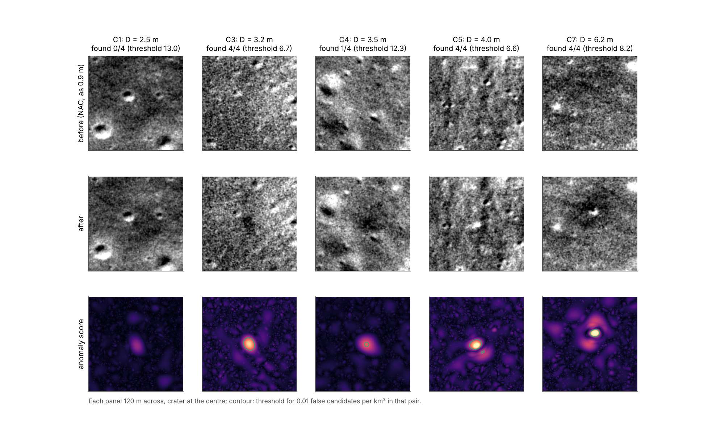
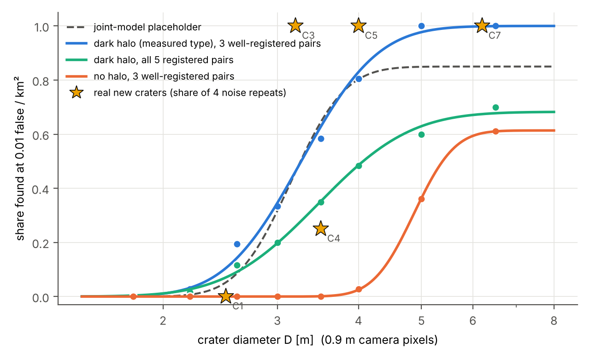

> The team downloaded four LRO data sets: the LROC new-crater catalogue, three tiles of the WAC 643 nm albedo mosaic, the LOLA 64-pixel-per-degree topography and 16 NAC images of eight new craters. This note uses them to test two assumptions of the revision-5 simulations. The first is the moving lunar texture in the event-camera false-alarm budget (simulation S10). The second is the crater-confirmation curve of the crater camera (S14). The full event-stream simulation is not part of this work. **None of the proposal's numbers has been changed.** Section 4 lists the changes the results support; they need the team's decision.

# 1. Summary

| Question | Revision-5 assumption | Result with LRO data | Effect on Option A pairs |
|---|---|---|---|
| Do moving albedo and slopes in earthshine cause false triggers? | A contrast-2 edge in 1% of all trigger groups | The measured near-side texture stays within the 1-per-hour budget at the adopted thresholds. The one exception is the tuned-bias IMX636 under the brightest earthshine (9.6 per hour), which needs higher 2 s thresholds. | 0% when thresholds are only raised. +0 to +4% if they are also lowered where the measurement allows it. |
| How small a fresh crater does the crater camera confirm? | 50% at 3.5 camera pixels (3.15 m), width 0.15, plateau c_max = 0.85 | On real before/after NAC pairs degraded to the camera: 50% at **3.6 pixels (3.3 m)**, width 0.21. Real new craters are found by their **dark reflectance halos** and not by the bowl. The plateau depends on how well each pair is registered. | −6% (well-registered pairs, c_max 0.85). Down to −31% if two pairs in five are registered as poorly as the worst usable pairs here. |

The proposal's assumptions survive both tests. The crater test adds two design requirements that the proposal does not yet state. The before/after images must be registered locally to about 0.1 NAC pixel. The search must look for reflectance anomalies of either sign, not only for the shading of a bowl.

# 2. Moving lunar texture and event-camera false triggers

**Data and method.** The event camera drifts over the Moon at 0.41 pixels per second (0.9 km pixels from 3000 km). Wherever earthshine lights the night side, albedo contrast and slopes therefore brighten some pixels during a trigger window. [`texture_map.py`](../../analysis/flash_crater_models/texture_map.py) builds the earthshine background of each 0.9 km pixel from two products:

- the WAC Hapke-normalised 643 nm albedo, from tiles E350N0450, E350N3150 and E350S3150, i.e. 70°S–70°N and 270–90°E, the whole near side;
- Lunar-Lambert shading of the LOLA slopes for the Earth at the sub-Earth point.

The model covers 13 million pixels within 60° of the equator where the Earth is more than 10° above the horizon. For each window W it histograms the summed log-brightness rise of every 2×2 and 3×3 trigger group, for background levels of 1.3×10⁴ and 2.5×10⁴ e⁻/s (dark current plus earthshine; the brightest earthshine in the observing population, 1.85×10⁴ e⁻/s, gives about 2.5×10⁴ e⁻/s) and for the warm-sensor levels of 4×10⁴ and 6×10⁴ e⁻/s. [`texture_measured.py`](../../analysis/flash_crater_models/texture_measured.py) adds the resulting event counts to the version-4 null model. It applies the trigger rule exactly (group sum ≥ n_min with at least three pixels contributing) and evaluates the false-trigger rate over 5.3×10¹² tests per hour.

**How many events does a slow brightening produce?** A contrast-threshold pixel on a slow, smooth rise fires almost deterministically. In a simulation of the version-4 pixel model (shot noise, photoreceptor, threshold spread, background activity) under a steady ramp, the added count variance was **0.08–0.27 times the mean**, not the Poisson value of 1. The adopted count model is a binomial with variance 0.35 × mean. A Poisson count is kept as a bounding case.

**Results.** The measured texture is close to the assumed edge at the 99.9th percentile. For the nominal sensor at 2.5×10⁴ e⁻/s in the 2 s window, 0.1% of 2×2 groups receive more than 4.8 counts, while the assumed edge adds 4.5 counts in 1% of groups. The measured distribution then ends steeply (Figure 1a): 0.01% of groups exceed 7.5 counts and none exceed 16.

Table: False triggers per hour (six heads) with the adopted version-4 thresholds. Budget: 1 per hour.

| Sensor | Background [e⁻/s] | Assumed edge (design) | Measured texture | Measured, Poisson bound |
|---|---|---|---|---|
| Nominal (revision 5) | 1.3×10⁴ | 0.39 | 0.09 | 0.43 |
| Nominal | 2.5×10⁴ | 0.20 | 0.12 | 21.9 |
| Measured IMX636 (sensor trade) | 1.3×10⁴ | 0.18 | <0.001 | 2.0 |
| Measured IMX636 | 2.5×10⁴ | 0.35 | 0.95 | 125 |
| IMX636, tuned biases (C = 0.10) | 2.5×10⁴ | 0.39 | **9.6** | 61 |
| Pessimistic (warm, 5.55 fA) | 6×10⁴ | 0.18 | 0.16 | 0.17 |
| IMX636, warm | 6×10⁴ | 0.25 | 0.002 | 1.5 |

With the adopted count model, every case meets the budget except the tuned-bias IMX636 under the brightest earthshine. That case needs 2×2/3×3 thresholds of 77/134 counts in the 2 s window instead of 70/116. The Poisson bound would exceed the budget in five of these cases, but only because Poisson counts overstate the spread of a deterministic rise (see above). Even under that bound, the map-based alternative is small: masking 0.04% of trigger groups, predicted on board from the albedo and topography maps, restores the budget at the adopted thresholds.

**Effect on detection and yield.** The flashes of the version-4 grid were simulated again with the same random seeds; the stored detections are reproduced exactly. They were then detected with three new threshold sets.

Table: Option A pairs in 2.5 years (deterministic, nominal factors; median of the Monte Carlo in brackets; one population and one random stream for all columns).

| Sensor | Adopted (revision 5 / trade) | Raised only where the texture needs it | Raised to the Poisson bound | Texture-aware (raised and lowered) |
|---|---|---|---|---|
| Nominal | 294 (208) | 294 (208) | 294 (208) | 297 (208) |
| Pessimistic | 93 (74) | 93 (74) | 93 (74) | 93 (74) |
| Measured IMX636 | 384 (257) | 384 (257) | 384 (257) | 400 (267) |
| IMX636, tuned biases | 422 (277) | 422 (277) | 422 (277) | 424 (278) |
| IMX636, warm | 352 (240) | 352 (240) | 352 (240) | 356 (241) |

Raising the long-window thresholds costs no simulated detections. Flashes near the threshold trigger first in the 0.05–0.8 s windows, and the brightest earthshine is rare in the observing population. The texture-aware set lowers most thresholds by one to five counts, because the declared edge was more pessimistic than the measured texture for most windows. That would gain up to 4% (IMX636).

**Limits.** The model resolves 0.9 km and has earthshine only (no change of the Earth's phase within a window, no scattered light). It covers latitudes within 60°; the far side has no earthshine and no texture. The energy grid of the detection tables (steps of ×2–2.5) cannot show small threshold shifts.

# 3. Real new craters at crater-camera resolution

**Data and method.** The new-crater catalogue (222 craters; Speyerer et al. 2016) gives the diameter and the before/after NAC images of each crater. We chose eight craters of 2.5–9.8 m with Sun incidences of 27–52°. The before and after images of each pair were taken within 2.5° of the same incidence. [`real_pairs/`](../../analysis/crater_injection_test/real_pairs) in the crater kit:

1. registers each pair, first with a global affine fit to image features and then with a smooth residual shift field from sub-pixel correlation of 192-pixel tiles;
2. degrades both images to the TriScape200 at 300 km, with 0.9 m pixels, blur, shot and read noise, and RGB Bayer sampling;
3. sets a detection threshold for 0.01 false candidates per km² from the real pair itself, with the crater's surroundings masked.

Two detectors are compared. The kit's **bowl** matched filter looks for the shading of a fresh bowl with a bright halo. The new **anomaly** detector is a multi-scale Laplacian-of-Gaussian of the locally gain-matched difference, sensitive to bright and dark changes alike.

**Registration decides the false-alarm level.** After the global fit the pairs still had residual shifts of 0.45–2.4 NAC pixels rms, because NAC images are not orthorectified. The local correction reduced this to 0.06–0.10 pixels for three pairs (C3, C5, C7), 0.12–0.16 pixels for two (C1, C4) and only to 0.44–0.95 pixels for three (C2, C6, C8). Those last three pairs could not be used, and their craters were not located. With anomaly thresholds for the same false-alarm density of 17–62, the craters are hidden by misregistration residuals.

Table: Located real new craters at 0.9 m (4 noise repeats; threshold for 0.01 false candidates per km² of the same pair).

| Crater | D | NAC pixel | Residual shift | Anomaly threshold | Found (anomaly) | Found (bowl) | Reflectance change within 0.5 D | Halo radius (2% level) |
|---|---|---|---|---|---|---|---|---|
| C1 | 2.5 m | 0.52 m | 0.16 px | 13.0 | 0/4 | 0/4 | −11% | 3 D |
| C3 | 3.2 m | 0.54 m | 0.10 px | 6.7 | **4/4** | 0/4 | −9% | 3 D |
| C4 | 3.5 m | 0.75 m | 0.12 px | 12.3 | 1/4 | 0/4 | −12% | 6 D |
| C5 | 4.0 m | 0.66 m | 0.06 px | 6.6 | **4/4** | 4/4 | +23% | 1.5 D |
| C7 | 6.2 m | 0.49 m | 0.06 px | 8.2 | **4/4** | 4/4 | −6% | 4 D |

In the three well-registered pairs the anomaly thresholds (6.6–8.2) are close to the noise-only level of the bowl filter (5.8–6.5). In those pairs the 3.2, 4.0 and 6.2 m craters are found in every repeat. In the two pairs with 0.12–0.16 pixels of residual shift, the threshold is twice as high, and the 2.5 m and 3.5 m craters are missed or found once. This test does not separate residual misregistration from other differences between the two images, such as the camera (NAC-L versus NAC-R) and the pixel scale.

**Real new craters are dark.** Four of the five located craters are surrounded by a **dark** halo of −6 to −12% that is still −2 to −3% at 2–4 crater diameters (Figure 2). Only C5 is bright. The kit's crater model assumed a bright halo of +7.5–10% out to 1.5 D. The bowl filter, which expects bright ejecta, therefore misses all three dark-halo craters below 4 m, while the anomaly detector finds the well-registered one.

**Injection into the real pairs.** Fresh craters with depth/diameter 0.14 and halos of the measured type (−8%, decaying to 10% of that at 6 radii) were injected into the five usable pairs, 60 per diameter from 1.8 to 6.5 m, and detected with the anomaly detector at each pair's threshold (Figure 3).

Table: Fitted confirmation curve c(D) = c_max · Φ((ln D − ln(k · 0.9 m)) / w).

| Case | k (50% point) | 50% diameter | Width w | c_max |
|---|---|---|---|---|
| Joint-model placeholder | 3.5 px | 3.15 m | 0.15 | 0.85 |
| Dark halo, three well-registered pairs | **3.63 px** | **3.3 m** | **0.21** | 1.00 (36/36 at ≥5 m) |
| Dark halo, all five pairs | 3.85 px | 3.5 m | 0.26 | 0.68 |
| Weak dark halo (−4%), well-registered pairs | 5.35 px | 4.8 m | 0.12 | 0.73 |
| No halo, well-registered pairs (anomaly detector) | 5.41 px | 4.9 m | 0.11 | 0.61 |
| Earlier result: same-tile test, bowl filter, bright halo | 3.58 px | 3.2 m | 0.10 | 0.99 |

Table: Option A pairs in 2.5 years at nominal factors for these curves (`real_pairs_yield.py`).

| Sensor | Placeholder | Well-registered pairs, c_max 0.85 | Well-registered pairs, fitted c_max 1.0 | All five pairs (c_max 0.68) |
|---|---|---|---|---|
| Nominal | 294 | 277 (−6%) | 325 (+11%) | 202 (−31%) |
| Measured IMX636 | 384 | 367 (−4%) | 431 (+12%) | 267 (−30%) |
| Pessimistic | 93 | 89 (−4%) | 104 (+12%) | 68 (−27%) |

The 50% point agrees with the placeholder within 4%. The yield then rests on the plateau c_max, i.e. on how many pairs reach the well-registered state. The proposal's Monte Carlo already varies c_max between 0.65 and 0.95, so the "all five pairs" case lies at the pessimistic edge of its yield range.

**Limits.** Five craters, three of them in well-registered pairs, give a small sample. The located craters may be the more visible ones, because the three craters that were not found sit in poorly registered pairs. The pairs are NAC–NAC; the mission pairs will be TriScape200–NAC, with different optics, colour sampling and viewing geometry. The real craters were 2–8 years old when their after images were taken, whereas the mission images craters weeks to months after the flash. Their halos may differ, probably in favour of detection. Thresholds come from 3–9 km² of null area per pair, extrapolated with an exponential tail. The diameter error was not measured on real pairs.

# 4. Proposed changes (for decision)

The results support the following changes. None has been applied to the proposal or the simulation notes.

1. **S10, texture term.** Replace the declared "contrast-2 edge in 1% of groups" with the measured near-side texture, and state the count model, i.e. near-deterministic response to a slow rise, checked by simulation. Keep the adopted thresholds. For the tuned-bias IMX636, raise the 2 s thresholds to 77/134 counts. Mention the on-board texture mask (0.04% of groups) as a fallback under the Poisson bound.
2. **S14, crater confirmation.** Keep k = 3.5 px (measured 3.6 px on real pairs). Widen w from 0.15 to 0.2. State that c_max = 0.85 assumes local before/after registration to about 0.1 NAC pixel (about 6 cm) and a reflectance-anomaly search. With registration as achieved for the two poorer pairs here, c_max is about 0.68.
3. **New requirements for the crater-imaging pipeline:** orthorectify the archive image and the TriScape200 image (LOLA/NAC terrain models), followed by a local residual correction, and search for dark and bright reflectance changes. Both belong to the ground segment; the second is already implemented in the kit.
4. **Crater kit.** Add the anomaly detector and the measured dark-halo model to the kit's standard runs. The team's human review should use well-registered pairs only.

# References

- Speyerer E. J. et al. (2016), *Quantifying crater production and regolith overturn on the Moon with temporal imaging*, Nature 538, 215–218. Catalogue: [LROC new-crater shapefile](https://data.lroc.im-ldi.com/lroc/view_rdr/SHAPEFILE_GLOBAL_NEW_CRATERS)
- Sato H. et al. (2014), *Resolved Hapke parameter maps of the Moon*, JGR Planets 119, 1775–1805 (basis of the WAC Hapke-normalised 643 nm mosaic, product WAC_HAPKE_643NM).
- Smith D. E. et al. (2010), *The Lunar Orbiter Laser Altimeter investigation on the Lunar Reconnaissance Orbiter mission*, Space Sci. Rev. 150, 209–241 (LDEM_64). [PDS Geosciences LOLA products](https://pds-geosciences.wustl.edu/missions/lro/lola.htm)
- McReynolds et al. (AMOS 2025), IMX636 characterisation, as used in the [sensor trade](../sensor_trade/sensor_trade.md).
- Earlier crater test: [crater-test note](../crater_test/crater_test_results.md).
