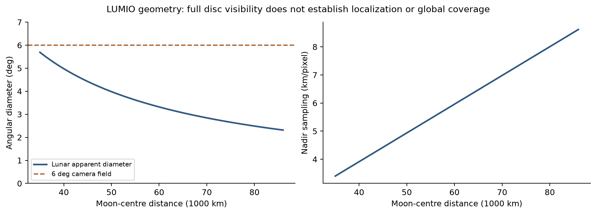
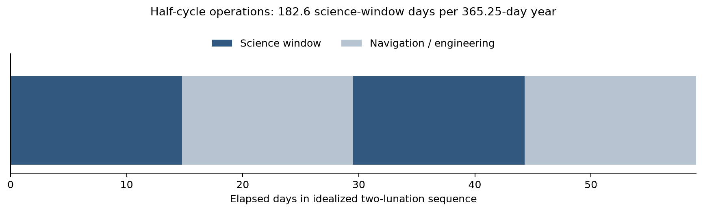
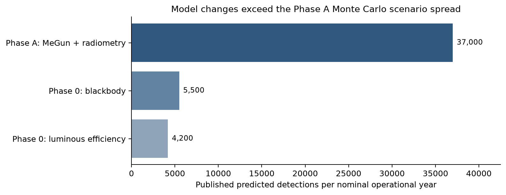
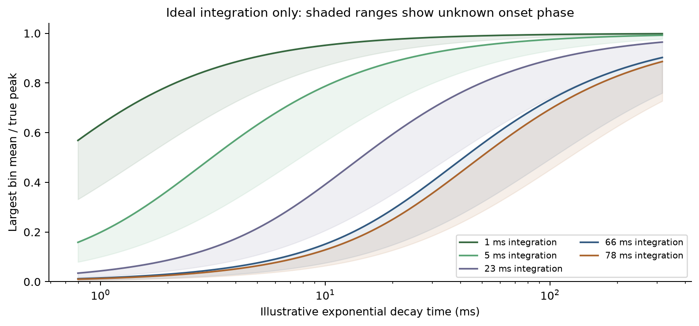

# LUMIO comparison for the SMD event-camera mission

**Evidence cut-off: 29 October 2026. Completed concept research.** This is supporting research, not the final 50-page mission-design report. LUMIO values retain their design epoch. SMD numerical thresholds, hardware, architecture and lifetime remain TBR.

## 1. Conclusions for concept selection

LUMIO combines a scientific investigation of lunar meteoroid impacts with demonstration of small-spacecraft technologies in lunar space. It is a serious comparator for SMD: it already proposes two-band confirmation, optical-energy measurements, temperature inference, autonomous onboard reduction and a long farside observing window. Neither farside access nor a second colour is a new SMD contribution. The most focused SMD hypothesis remains **calibrated measurement of early flash evolution relative to total optical energy**, if useful samples can be obtained beyond the temporal information available from LUMIO and modern ground monitoring. This study establishes the comparison and the necessary evidence; it does **not** establish that an event sensor achieves that gain. [L02](https://www.esa.int/Enabling_Support/Space_Engineering_Technology/Technology_CubeSats/LUMIO), [L06, pp 2-3](https://re.public.polimi.it/retrieve/f609816c-3cf5-4468-93bc-12ee09e38135/PANCM01-24.pdf), [L22, abstract and results](https://arxiv.org/html/2606.07177v1).

The strongest dated status is Phase C begun in March 2026, CDR planned in 2027 and **potential launch in 2028**. June and July 2026 prime reports confirm ongoing Phase-C work, rather than completed flight qualification. ESA describes 12 U/12 UXL and about 30 kg; ASI lists **16 U**. The conflict is unresolved: the reviewed sources do not document a change decision that explains it. Use a 2024 payload comparator with a separate 2026 status overlay, rather than a synthetic current spacecraft budget. [L01](https://www.esa.int/Enabling_Support/Space_Engineering_Technology/Shaping_the_Future/A_leap_forward_for_Lumio_Phase_C_officially_launched), [L03](https://www.asi.it/en/technologies-and-engineering/micro-and-nanosatellites/esa-gstp-fly-program/lumio/), [L13](https://www.aero.polimi.it/en/magazine/lumio-consolidation-review), [L14](https://www.aero.polimi.it/en/magazine/daer-hosts-the-annual-esa-lumio-science-team-meeting).

## 2. Mission statement, science and actual criteria

**Paraphrased mission statement:** use a small spacecraft near Earth-Moon L2 to observe and characterize impact flashes on the lunar farside, complement nearside ground monitoring, and improve knowledge of the lunar meteoroid environment for science and exploration. The science question concerns the spatial and temporal characteristics of impacting meteoroids. The measured observable is light; impact energy, mass and size are derived through additional physical assumptions. Hazard-model improvement is an application, not evidence of an operational warning service. [L17, p 311 section 2](https://doi.org/10.1016/j.actaastro.2022.03.032), [L02, mission description/objectives](https://www.esa.int/Enabling_Support/Space_Engineering_Technology/Technology_CubeSats/LUMIO).

| Layer | Publicly documented intent | How it should be evaluated |
| --- | --- | --- |
| Science | Flash catalogue, flux/magnitude/luminous-energy distributions, inferred sizes and locations; equivalent blackbody temperature from two bands | Validated events, measurement uncertainty, selection function and area-time exposure |
| Complementarity | Extend spatial, temporal and measurement access beyond ground observations | Match bandpass, thresholds, coverage, cadence and uncertainties |
| Technology | Optical autonomous navigation experiment, trajectory control, miniature optical/propulsion/platform technologies, onboard processing | Separate demonstrations and engineering verification from science success |
| Future application | Better cislunar meteoroid and exploration-hazard models | Do not equate catalogue production with alerts or validated risk prediction |

Source: [L18, Tables 1-3 p 3 and section 2.3 p 4](https://doi.org/10.1016/j.icarus.2022.115213), [L02](https://www.esa.int/Enabling_Support/Space_Engineering_Technology/Technology_CubeSats/LUMIO). The old TLO.04 relay objective belongs to an earlier architecture; nominal modern navigation/communications are direct to Earth.

There **are published quantitative acceptance criteria**. They are the **2018 orbit-trade criteria**, not verified current Phase-C contractual success thresholds:

| Published ID | Acceptance criterion, paraphrased | Meaning and limitation |
| --- | --- | --- |
| EC.A.01 | Detect impacts over Earth-equivalent kinetic energy 10^-6 to 10^-1 kton TNT | Not band-limited optical energy; requires the source's Earth/Moon energy mapping |
| EC.A.02 | At least 240 impacts over mission life | Reference sample scale motivated by the ground-monitoring literature |
| EC.A.03 | At least two impacts in 10^-4 to 10^-1 kton TNT | Sparse high-energy criterion, not a precise population measurement |
| EC.A.04 | At least 100 impacts in 10^-6 to 10^-4 kton TNT | Lower-energy sample criterion |
| EC.A.05 | Monitor the farside at night | Farside requirement, not independent whole-Moon coverage |
| EC.A.06/07 | At least one-year life and accessible orbit within total 200 m/s | Historical 24 kg/launch assumptions |

[L20, section 2.1](https://doi.org/10.3389/fspas.2018.00029). Its selection criteria maximize detections and full-disc time while minimizing delta-v. In simple Poisson counting, 240 events give 6.45% fractional counting uncertainty and two give 70.7%; these calculations do not supply flux-systematic or photometric accuracy. No current public definition of **minimum versus full success**, comprehensive pass/fail matrix, or confirmed current count allocation was established in the reviewed sources.

Later published requirements are also useful, with their epoch preserved. The 2024 table specifies at least one year in lunar space, 12 U, mass at most 28 kg, at least 80 m/s propulsion capability, Moon-pointing absolute control error below 0.18 deg half-cone, relative error below 5 arcsec over 66.7 ms, and radio-navigation position accuracy 1 km at 3 sigma. Its payload table gives 450-950 nm and **integration time at least 30 ms**; the inequality must not be reversed into 30 ms resolution. Processor throughput of at least 15 images/s is not proof of camera cadence. [L05, Tables 3-1 p 5 and 6-1 p 10](https://re.public.polimi.it/bitstream/11311/1266785/1/TOPPF01-24.pdf).

## 3. Orbit, visibility and transfer

LUMIO's reference orbit is a three-dimensional **quasi-periodic halo about Earth-Moon L2**, seeded from CRTBP Jacobi constant Cj=3.09 and refined in a higher-fidelity ephemeris model. Cj describes the seed model; it is not a conserved constant of the full perturbed trajectory. Approximately two-week halo motion and roughly half-lunation science/engineering windows are operations approximations. A quasi-periodic orbit has no exact universal Keplerian period. [L20, sections 3.3.1-3.3.4](https://doi.org/10.3389/fspas.2018.00029), [L05, section 4.1 p 7](https://re.public.polimi.it/bitstream/11311/1266785/1/TOPPF01-24.pdf).

The documented trade balances useful dark-farside exposure, full-disc framing for science and optical navigation, transfer cost, stationkeeping, safety and CubeSat resource limits. A large halo provides Earth visibility while keeping the farside in view and avoiding earthshine on the principal target hemisphere. The studied operational trajectories are eclipse-free; that is a result for those designs, not a universal property of all L2 orbits. Full-disc visibility is geometric access, not continuous flash observability. Sun exclusion, illuminated terrain, terrain occultation, detector performance and operational losses still apply. [L20, sections 2.1 and 3](https://doi.org/10.3389/fspas.2018.00029), [L07, slides 4-7](https://www.asi.it/wp-content/uploads/2024/07/04.07_2_5_PoliMi.pdf).

The 2023 model uses Moon-centre distance **36000-86000 km**, Earth-centre distance **380000-470000 km**, and assumed operations in March 2024-March 2025. These are historical simulation inputs, not events that occurred. The 2024 paper rounds the Moon range to 35000-85000 km. ESA's 2026 overview gives about 40000-80000 km; its wording describes the spacecraft vantage range, not the L2 point moving between those distances. [L18, section 2.2 p 4 and Fig 5](https://doi.org/10.1016/j.icarus.2022.115213), [L05, p 5](https://re.public.polimi.it/bitstream/11311/1266785/1/TOPPF01-24.pdf), [L01](https://www.esa.int/Enabling_Support/Space_Engineering_Technology/Shaping_the_Future/A_leap_forward_for_Lumio_Phase_C_officially_launched).

With a spherical Moon of radius 1737.4 km and a nominal 6 deg/1024-pixel camera, this study calculates:

| Moon-centre distance | Apparent lunar diameter | Near-nadir target range | Approximate nadir sampling |
| --- | --- | --- | --- |
| 35000 km | 5.69 deg | 33262.6 km | 3.40 km/pixel |
| 36000 km | 5.53 deg | 34262.6 km | 3.50 km/pixel |
| 50000 km | 3.98 deg | 48262.6 km | 4.94 km/pixel |
| 86000 km | 2.32 deg | 84262.6 km | 8.62 km/pixel |

Angular sampling is about 21.09 arcsec/pixel. Local surface sampling worsens toward the limb. These numbers do not include pointing knowledge, boresight error, navigation or topography and are **not localization accuracy**. The instantaneous visible cap is only 47.6-49.0% of the Moon at 36000-86000 km. A full disc therefore does not establish coverage of the entire surface over a mission. No new ephemeris coverage map was computed here. For the same fixed emitted spectrum/geometry at the sub-spacecraft point, the inverse-square signal varies by about 6.05 across these near/far ranges; using centre distance instead gives 5.71. This isolates range only, not detection probability.

### Transfer cases must remain separate

| Epoch | Architecture and budget | How to use it |
| --- | --- | --- |
| Phase 0/2018 | Lunar-orbiter release, then manifold transfer; 154.4 m/s is the paper's 1-sigma **whole-mission** total (Table 12, including one-year stationkeeping and disposal; 192.9/227.0 m/s at 2/3 sigma, while its §3.3.4 text quotes 191.3 m/s at 3 sigma) | Historical programme/relay assumptions; not a universal modern delta-v |
| Phase A/2022 paper | Lunar-delivery CLPS case 119.5 m/s margined versus Artemis 2 trans-lunar release case 201.8 m/s | Explicitly different release conditions; both are studies |
| Phase B/2024 | WSB piggyback, release 0.5 day after TLI, independent deep-space manoeuvres and halo insertion; 79.05 m/s total table | Carrier's multi-km/s Earth-departure injection is outside LUMIO's Layer 2 budget |
| Current public plan | DTE chemical-propulsion transfer; WSB piggyback and lunar-delivery opportunities discussed; potential launch 2028 | No launch contract or final injection state established here |

Sources: [L20, Table 12](https://doi.org/10.3389/fspas.2018.00029), [L17, pp 312-314 Table 1](https://doi.org/10.1016/j.actaastro.2022.03.032), [L05, pp 7-8 Table 4-1](https://re.public.polimi.it/bitstream/11311/1266785/1/TOPPF01-24.pdf), [L02](https://www.esa.int/Enabling_Support/Space_Engineering_Technology/Technology_CubeSats/LUMIO).

The Phase-B selected example was week 20 of 2027, with a manoeuvre 44.85 days after injection and about 50 further days to halo insertion. A separate 2024 navigation timeline allows about 150 days for commissioning and transfer. Neither is the final booked flight timeline. The Phase-B stationkeeping prediction is mean 8.256 m/s/year, with 15.79 m/s at its stated 3-sigma budget and a two-day tracking cut-off. These are mission-team Monte Carlo results, not simulations rerun in this study. L2 halos require active maintenance; environmental acceleration times duration is not a stationkeeping calculation. [L05, sections 4.2-4.4 pp 7-8](https://re.public.polimi.it/bitstream/11311/1266785/1/TOPPF01-24.pdf), [L21, p 2](https://re.public.polimi.it/bitstream/11311/1260531/1/PANIP01-24.pdf).

## 4. Duration: what is known, and why one year?

**One year is the nominal operational duration, not one year of science live time.** It is an explicit minimum-life criterion in the original orbit trade and remains the current operations plan. The 2024 platform presentation gives 1.5-year design life with more than one year in the lunar environment. Transfer, commissioning, calibration, engineering, recovery and decommissioning must be accounted for separately. The prime's Phase-C project interval 2 March 2026-30 September 2027 is a development record, not a science mission lifetime. [L20, EC.A.06](https://doi.org/10.3389/fspas.2018.00029), [L02, operations](https://www.esa.int/Enabling_Support/Space_Engineering_Technology/Technology_CubeSats/LUMIO), [L07, slide 8](https://www.asi.it/wp-content/uploads/2024/07/04.07_2_5_PoliMi.pdf), [L04](https://www.aero.polimi.it/en/research-projects/esa-lumio-lunar-meteoroid-impacts-observer--phase-c).

**Documented rationale:** the orbit trade explicitly connects a larger useful sample and longer life with improved meteoroid models; reducing delta-v can preserve resources for more observations. It states the one-year floor and a sample threshold justified by the existing ground-observation sample. **Not established:** a documented optimization demonstrating why exactly one year, rather than six months or two years, was chosen, or that radiation, funding, a particular shower or propellant exhaustion uniquely set the duration. An annual interval plausibly samples seasonal meteoroid populations, but that is an engineering/scientific inference here. It does not ensure that every shower peak lands inside usable dark windows. [L20, section 2.1](https://doi.org/10.3389/fspas.2018.00029).

For an ideal half-science/half-engineering schedule, using 365.25 days/year and 29.53059 days/synodic month as declared conversion conventions, this study calculates **12.37 lunations and 182.625 science-window days =4383 hours**. This is an upper scheduling allowance before additional exclusions, not predicted delivered live time. At 90% or 70% additional availability it becomes 3944.7 or 3068.1 hours. The ESA profile's 28-day shorthand and the roughly 14-day engineering/science windows should not be interpreted as an exact astronomical month. [L02](https://www.esa.int/Enabling_Support/Space_Engineering_Technology/Technology_CubeSats/LUMIO), [L21, p 2](https://re.public.polimi.it/bitstream/11311/1260531/1/PANIP01-24.pdf).

Using the 2023 paper's rough mean observed dark area of 3/8 of the whole Moon during science, half-year operation and 20% terrain obstruction gives **4.99e10 km² h**, equivalent to 0.15 whole-surface-years. This is a reproduction of a rough source scaling, not a geographic exposure map or new completeness estimate. The true useful count must integrate position-, energy-, spectrum- and profile-dependent recovery, not multiply one universal rate by this area-time. [L18, section 6 pp 13-15 and footnote 21](https://doi.org/10.1016/j.icarus.2022.115213).

### Published sample predictions are model dependent

The 2023 paper attributes about 4200 (luminous-efficiency method) or 5500 (blackbody method) detections to the 2018 study (L18 p 13; the 2018 paper itself gives only a 10³–10⁴ range for halo orbits); the 2023 integrated model gives **37000 with scenario standard deviation 830**, including about 720 in its high-energy bin. Its 1000 stochastic scenarios, source flux law, source-dependent velocity/energy distributions, old camera model and assumed 2024-2025 geometry determine the result. The 2.24% scenario spread is not a full mission prediction uncertainty. The paper itself explains that alternative flux laws differ by about 13.7 near a relevant energy scale. It also contains conflicting Geminids peak statements (>250 versus>6000 per day); no single peak rate is adopted here. [L18, Tables 8-9 p 14, section 6 and conclusion](https://doi.org/10.1016/j.icarus.2022.115213).

SMD must predict **useful characterized samples**, not copy LUMIO detection counts. A later launch changes lunar-phase/shower alignment; a new bandpass, camera cadence or selected observable requires a new coupled yield model. More lifetime can help, but seasonal sampling is not a guaranteed linear multiplier. The Phase-A paper describes possible extensions when a cheaper transfer preserves propellant; no approved extension duration is established. A2025 Apophis opportunity study does not itself extend the baseline mission. [L17, p 312](https://doi.org/10.1016/j.actaastro.2022.03.032), [L12](https://doi.org/10.5194/epsc-dps2025-1514).

## 5. Why CubeSat, and why this size?

The programme origin is the answer to **why CubeSat**. The original ESA LUCE material solicited miniature science and technology-demonstration missions compatible with lunar piggyback delivery. Its 2017 slide 5 specifies individual satellites below 24 kg and below 12 U, total below 60 kg, relay communications through a lunar orbiter, about one hour/day contact, and ten days autonomous operation. The circular-orbit/inclination text on that slide belongs to the programme context and should not be misapplied as the final halo orbit. ESA's 2018 winner announcement explicitly presents low-cost CubeSat standards and emerging lunar piggyback opportunities as the setting. This is not evidence of a free optimization across all spacecraft classes. [L19, slides 3-6](https://icubesat.org/wp-content/uploads/2017/05/2017-a-1-2-20170530-luce.pdf), [L08](https://www.esa.int/Enabling_Support/Space_Engineering_Technology/CubeSats_for_hunting_secrets_in_lunar_darkness).

The later form factor reflects accommodation and risk trades within that programme. The camera needs aperture, a long baffle, two focal planes, electronics and a radiator interface; deep-space operations also need main propulsion, RCS, articulated arrays, DTE communication and computation. The 2022 paper explicitly leaves 12 UXL open to accommodate baffle volume; the 2024 structure has lateral protrusions and is not fully standard 12 U. The 2024 slides allocate roughly 3 U optical head plus 1 U proximity electronics. Historical wet mass grows from about 21 kg through 22.8 kg to 28.69 kg as redundancy, margins and transfer assumptions change. [L17, pp 312-316](https://doi.org/10.1016/j.actaastro.2022.03.032), [L05, section 6.5 p 13](https://re.public.polimi.it/bitstream/11311/1266785/1/TOPPF01-24.pdf), [L07, slide 5](https://www.asi.it/wp-content/uploads/2024/07/04.07_2_5_PoliMi.pdf).

**SMD implication:** reuse the discipline of fitting a complete mission into a small system; do not inherit the 12 U boundary. SMD permits any proportionate platform and requires entire-surface coverage. A larger aperture, alternative orbit or more than one spacecraft needs a science/resource justification; a small bus does not by itself mean low programme cost. No compatible total LUMIO lifecycle cost or source-controlled current volume/mass model was established, so no cost-per-useful-flash ranking is defensible.

## 6. Source-backed design across the eight subsystems

These are **published designs or targets**, not flown LUMIO performance. The machine-readable [claim register](../../data/lumio_comparison/claims.csv) has 43 entries with conditions, evidence status, source location, confidence and public gaps.

| Subsystem | Reliable design detail | Epoch/source and remaining limit |
| --- | --- | --- |
| Payload |50.8 mm pupil,127 mm focal length, f/2.5, total 6 deg Fo V; two 1024 x 1024 CCD201-20 EMCCDs; seven-lens optical design | October 2024; L06 pp 2-3 Tables 2-3. No current measured end-to-end response curve |
| Payload |450-800 nm VIS and 850-950 nm NIR; minimum full-frame integration about 78 ms/~13 fps; sync error negligible relative to exposure | L06 p 2 Tables 1-2. Older model 66 ms/15 fps and ideal 820 nm split remains a different comparator |
| Payload |Design optical transmission 78% VIS/84% NIR, including 30 krad load on first two lenses | L06 p 3 Table 3. Excludes manufacturing/alignment effects; not total QE or sensor qualification |
| Power Subsystem |Two deployable arrays with IMT micro SADA, rotating slip-ring assembly; Volta PCDU with MPPT/BCR and protected rails; ABSL124 Wh 7S2P Li-ion battery/~28 V | L05 pp 12-13 section 6.3. Available/usable energy, mode durations and final EOL generation remain unclosed publicly |
| Power Subsystem |July 2024 generation about 110 W; 4 S mode table 98.76 W available,88.94 W margined science,192.27 W manoeuvre | L07 slide 8; L05 p 14 Table 6-4. Different conventions and unreconciled requirements; no inferred continuous power closure |
| Thermal Control System |Detector straps to platform radiator, thermistors, heaters and active barrel temperature control; optics 14-26 deg C, detectors 0-10 deg C for performance | L06 pp 3-6, Table 5. All-camera operating -20 to 40 deg C and survival -30 to 50 deg C are separate ranges; hot cases need further optimization |
| Structure |Custom Argotec Al 7075 T7351 primary/secondary structure; protrusions beyond ordinary 12 U envelope; camera titanium barrel/Al 6082 baffle and compliant/isostatic mounting | L05 p 13; L06 pp 4-5. Final envelope, load case and qualification unavailable |
| Propulsion |Phase-B main propulsion: LMP-103S/helium blowdown, one ECAPS 1 N HPGP engine; four R134a cold-gas RCS thrusters for unloading/torque compensation | L05 p 11. LMO/ECAPS roles confirmed 2026 by L01; detailed post-Delta PDR performance not confirmed |
| Telecommunication Subsystem |DTE X-band, IMT C-DST, two patch antennas; TC, science, ranging/tracking; 2 W RF on mission slide | L05 p 13 section 6.4; L07 slide 9. No final station allocation, data-rate/link-margin/latency budget |
| Attitude Determination and Control Subsystem |XACT-100 with star trackers, gyroscopes, Sun sensors; three 100 m N m s wheels and one tilted 50 m N m s wheel; RCS unloading | L05 pp 11-12. These are momentum capacities, not torque; control errors differ from knowledge and localization |
| On-board Data Handling |Reworked Argotec Fermi CPU/FPGA, CAN interface, MRAM boot; separate S&T science reduction and two-channel validation | L05 p 13 section 6.6; L01 team roles. Exact current processor/memory/throughput/FDIR qualification not public |

Sources: [L05, pp 5-14](https://re.public.polimi.it/bitstream/11311/1266785/1/TOPPF01-24.pdf), [L06, pp 2-6](https://re.public.polimi.it/retrieve/f609816c-3cf5-4468-93bc-12ee09e38135/PANCM01-24.pdf), [L07, slides 5-9](https://www.asi.it/wp-content/uploads/2024/07/04.07_2_5_PoliMi.pdf), [L01](https://www.esa.int/Enabling_Support/Space_Engineering_Technology/Shaping_the_Future/A_leap_forward_for_Lumio_Phase_C_officially_launched).

Nominal radiometric navigation and an experimental limb-based optical-navigation chain must be distinguished. Published optical simulations use subpixel limb extraction and an EKF in Earth-Moon-barycentric J2000 coordinates; depth accuracy is poorer than image-plane accuracy. Their 0.2-pixel limb-extraction input/result does not demonstrate impact surface localization. [L21, pp 4-8 and results](https://re.public.polimi.it/bitstream/11311/1260531/1/PANIP01-24.pdf).

The 2023 science-product assumption is five 50 x 50-pixel tiles per impact, two channels and 16 bits/pixel: **0.4 Mbit/event** before overhead/compression. At 37000 events this is 14.8 Gbit/year, consistent with the paper's approximate 15 Gbit. By comparison, continuous two-channel full-frame 1024²x 16-bit acquisition at 15 fps would generate 503.3 Mbit/s or 5.44 TB/day in decimal units. This calculation explains onboard selection; it is not an actual camera-interface measurement or mission storage budget. Retain pre/post-flash information and selection diagnostics so reduction does not erase useful tails or bias the catalogue. [L18, p 4 section 2.3](https://doi.org/10.1016/j.icarus.2022.115213).

## 7. Conflict and arithmetic audit

| Issue | Findings and treatment |
| --- | --- |
|12 U/12 UXL versus 16 U | Preserve ESA/prime and ASI entries; no proved redesign |
|Schedule | Dated 2026 kickoff and potential 2028 launch preferred over undated March 2025/2027+ profile; prime records Delta PDR completed May 2025 |
|Camera | Updated bands/seven lenses/78 ms differ from older ideal split/five lenses/66 ms; use each as its own configuration |
|Transfer/propulsion | Release states, relay/DTE links, propulsion choices and confidence/margin conventions change; no blended delta-v |
|Mass |2024 requirement 28 kg versus total 28.69 kg; rounded subsystem margined lines sum 23.28 kg versus printed dry subtotal 23.41 kg. Printed subtotal+2.34 system+1.17 harness+1.77 propellant=28.69 kg |
|Payload allocation |20 W requirement and 19 W mode entry versus 27.8 W worst-case payload; 3.85 kg payload budget versus 4.8 kg system payload line, which also exceeds the PLD.004 4.5 kg payload limit |
|Power |98.76-88.94=9.82 W simple headroom, not printed 6.59 W. Requirement 68 W peak differs from 192.27 W margined manoeuvre demand |
|Battery |Manoeuvre deficit relative to 98.76 W array is 93.51 W.124 Wh/deficit gives 79.6 min ideal limit; usable SOC, efficiency, reserve, heater timing and degradation reduce it. No mission battery closure follows |
|RCS |110 N s requirement versus text 170 s called total impulse:retain unit/value ambiguity |
|Life/yield |Operations versus live time/design life; different transfer cases; predicted annual detections vary greatly and peak-rate text conflicts |

The detailed [conflict register](../../data/lumio_comparison/conflicts.csv) records 13 cases and sources. The budget discrepancies are findings about public tables; they do not prove the flight design is infeasible. They prevent treating those tables as a consistent current design. Reproduced delta-v line sums do equal 79.05 m/s, 0.95 m/s below the PROP-01 requirement of at least 80 m/s. [L05, pp 8,10-14](https://re.public.polimi.it/bitstream/11311/1266785/1/TOPPF01-24.pdf).

## 8. SMD comparison and the smallest useful next study

| Driver | LUMIO comparator | SMD implication / unresolved work |
| --- | --- | --- |
|D01 sensitivity |50.8 mm two-band EMCCD radiometric models | No matched sensitivity advantage established for provisional 1000 J event-camera target |
|D02 recording |66 ms old model; 78 ms full-frame Phase B; ground already 4-5 ms | Compare recovered early energy/profile detail at faint flux, not timestamp ticks |
|D03 photometry |Two colours support energy and temperature; current accuracy budget incomplete | Bound event-only/reference reconstruction, absolute scale, missing tails and spectral drift |
|D04 localization |Sampling/pointing/navigation published separately | Show full 95%surface error region; pixel scale is insufficient |
|D05 coverage |Farside observer complementary to ground | Preserve entire lunar surface including polar regions; L2 geometry alone does not close SMD |
|D06 sample |Historical criteria and thousands of model detections | Count useful jointly characterized events and independent samples |
|D07 reliability |Two-channel coincidence/retained tiles | Model false flashes and true-signal loss separately, including radiation and image motion |
|D08 envelope |Updated VIS/NIR bands, thermal and straylight limits | Define accepted spectrum/background/temperature/duration regimes |
|D09 life |One-year operations; engineering cycles; 1.5-year platform design | Derive lifetime from useful yield, reliability, resources and seasonal opportunity |
|D10 delivery |Batch downlink and onboard selection | Size buffering/contacts; add rapid delivery only if primary science requires it |

Sources and exact epoch are in [the comparison register](../../data/lumio_comparison/comparison.csv). SMD candidate values come from the [28 October D01-D04 study](../d01_d04_research_2026-10-28/d01_d04_research.md) and remain unapproved.

### Matched temporal comparison

For a deliberately simple exponential flux F(t)=F0 exp(-t/tau), t>=0, an ideal contiguous integration of duration T has best possible largest-bin mean/true peak

`g_best=(tau/T)*(1-exp(-T/tau))`.

Unknown onset phase gives worst largest-bin value

`g_worst=g_best/(2-exp(-T/tau))`.

The second expression equates the first two populated-bin integrals; it is independently checked in the calculation script. For tau=10 ms, best values are 0.952 at 1 ms,0.787 at 5 ms,0.151 at 66 ms and 0.128 at 78 ms. The corresponding worst-phase values are 0.869,0.565,0.0757 and 0.0641. These are **integration effects at identical incident signal**, with no noise, readout gap or sensor response. An ideal 1 ms event-derived bin is an assumption, not an attained event-camera result. No-gap integration preserves total energy when all bins are retained; it can still lose identifiable early structure and peak flux. NELIOTA's 23 ms exposures and readout gaps require an explicit gate model; that loss is not included in this plot. [L23, section 2](https://arxiv.org/html/2403.19613v1).

A fair radiometric comparison should send **the same incident spectral flash** through each system:range and emission geometry, aperture, bandpass/transmission/QE, PSF, pixel spread, background and straylight; then exposure/onset phase or event bandwidth/threshold/refractory loss; finally detection, confirmation and characterization cuts. Match photon counts or show them as an explicit consequence of aperture/range, never silently equalize both while claiming sensitivity superiority. The 2023 LUMIO SNR uses `10 log10(signal/noise)` and a 10 d B conservative threshold in that convention; later 5 d B processor text is not the same probability-of-detection standard. A current dual-band efficiency/false-rate curve and calibrated SMD chain are missing, so no normalized limiting-energy ranking is made. [L18, Eq 26 and section 5 pp 10-11](https://doi.org/10.1016/j.icarus.2022.115213), [L05, p 10](https://re.public.polimi.it/bitstream/11311/1266785/1/TOPPF01-24.pdf).

### Proposed one-objective hypothesis, not a baseline

**Question:** how does the fraction of band-limited flash energy emitted in the first 5 ms relate to total emitted energy in a defined class of lunar impacts? This is motivated by the small 2026 high-speed ground sample, which resolves complex shapes and indicates that initial intensity and total energy need not track each other. Its four events do not establish a population law. LUMIO already covers broader flux and colour objectives; SMD should add time-domain information with useful calibrated samples. [L22, results/discussion](https://arxiv.org/html/2606.07177v1).

Use first 5 ms relative to a defined recovered onset, retain a bounded tail, and define an energy/spectrum/background envelope. Compare the same underlying profiles after 66/78 ms LUMIO integration and 4/5 ms ground exposure, including selection and uncertainty. Start with provisional 1 ms/10000 J and 5 ms/3000 J SMD options, but select the least demanding mode that produces an identifiable scientific difference. Add a reference channel only if needed to close absolute/background/tail information; no automatic two-colour or spectroscopy commitment follows.

For a population mean with coefficient of variation CV, independent samples give approximate relative standard error `CV/sqrt(N)`. A trial CV=1 and 10%precision imply 100 useful events. A3-sigma distinction of a 20%mean difference between two equal groups needs about 450 events/group under that same variance assumption. These are **planning sensitivities**, not scientifically selected sample requirements; the pilot variance, measurement covariance, selection/systematics and the actual hypothesis must set N. If the fraction distribution is broad or classification is uncertain, the required number can rise substantially. Detection counts must be reduced by joint temporal/photometric/localization recovery. A model-based educational demonstration with bounded sensor uncertainties is acceptable; new hardware experiments are not a prerequisite.

Next authorized contributor work is a bounded coupled trade:one observable and uncertainty target; two or three realistic event-sensor/optics cases; minimal radiometric support; representative flash/background/particle/motion injections; whole-surface exposure for plausible architectures; useful yield and mode/resource budgets. Reuse the radiation and disturbance studies for their applicable availability/pointing contributions. No trajectory propagation, selected-sensor calibration, irradiation, hardware qualification or new LUMIO Monte Carlo was performed in this comparison.

## 9. Evidence, reproduction and remaining gaps

The [workbook](lumio_comparison_research.xlsx) contains the conclusions, criteria, timeline/conflicts,43-claim subsystem register, D01-D10 comparison, live calculations and 19-source register. The supporting PDF gives the concise review version. [Reproduction instructions](../../analysis/lumio_comparison_research/README.md),[calculation inputs](../../analysis/lumio_comparison_research/model_inputs.json),[derived results](../../data/lumio_comparison/calculation_results.json) and[validation](../../analysis/lumio_comparison_research/validation.json) distinguish executed checks from unperformed verification.

Public gaps remain:configuration-controlled Phase-C envelope/mass, payload response and absolute timing/photometric accuracy, current useful-event/false-rate thresholds, selected launch/transfer, final propulsion and battery/mode closure, current storage/downlink/ground commitments, total lifecycle cost, and approved extension. Local downloads of several Polimi PDFs returned HTTP403; their publicly indexed full PDF text was reviewed and cached as web extracts, with local-download limitations recorded. The supplied 2022/2023 PDFs and downloaded ESA/ASI material were retained intact. Web-extracted text is not a substitute for an unavailable original graphical table; where page rendering failed, the limitation is retained rather than implying a visual check.

The final mission-design report should use roughly 2-3 pages for the essential comparator and science gain, with detailed history/registers here. This page recommendation does not expand the inclusive 50-page mission-report budget. Whole-surface coverage, event-camera centrality and the one-objective direction remain unchanged.
