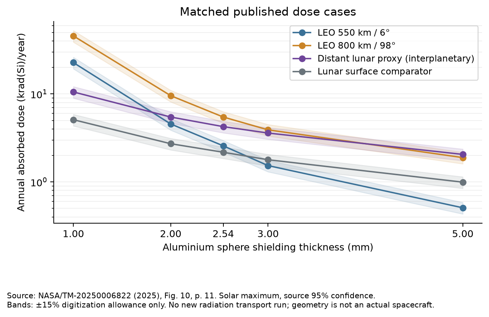
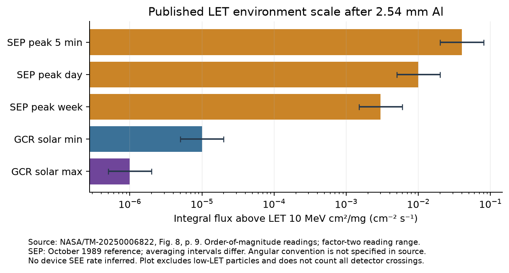
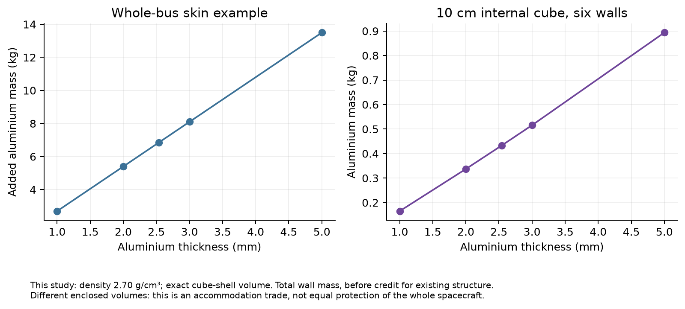
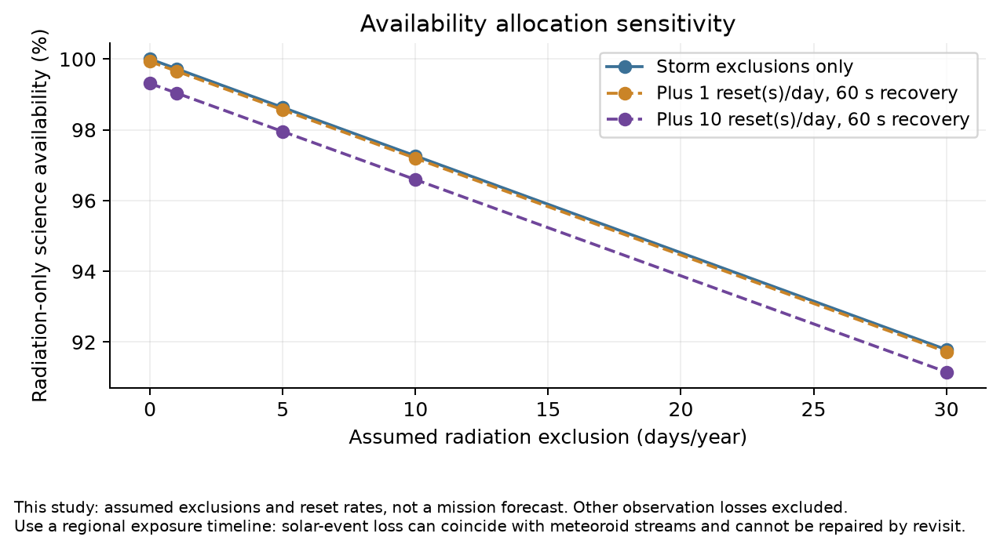

# Radiation environment for the lunar event-camera concept

Research completed 29 October 2026. All orbit, duration, shielding and component examples below are study fixtures. No mission requirement or architecture has been selected.

## Conclusions for the concept

**Radiation does not presently rule out the event-camera mission, but its science performance needs a sensor-specific degradation and particle-confusion allowance.** Existing event-camera flight and beam evidence supports further concept design. It does not establish calibrated lunar capability for IMX636. A recoverable electronics chain, protected power, adequate shielding paths and retained diagnostic data are proportionate concept measures. Adding a second spacecraft or optical channel solely because radiation exists is not justified by these results.

The strongest direct numerical comparison comes from one NASA publication using the same silicon target, solid aluminium sphere geometry, solar maximum and stated 95% confidence. At 2.54 mm Al, its digitized annual doses are approximately **4.3 krad(Si) for interplanetary space, 2.6 krad(Si) for 550 km/6° LEO, and 5.5 krad(Si) for 800 km/98° LEO**. The distant lunar observer can use the interplanetary case as a provisional exposure proxy. The corresponding ratios are approximately **1.7 and 0.78**. These are specific matched published cases, not a universal lunar/LEO multiplier. Source model versions and full inputs are unavailable. [RAD01](https://ntrs.nasa.gov/api/citations/20250006822/downloads/TM-20250006822.pdf), printed p 11, Fig 10.

For an illustrative three-year mission, the distant proxy at 2.54 mm gives 12.8 krad operational dose by arithmetic scaling. Adding an **assumed 1 krad transfer allowance** and applying an **assumed factor-two design margin** gives **27.5 krad(Si)**. A **30 krad procurement screening class** is therefore a useful starting trade for electronics. It uses the central curve reading: preserving the same margin at the +15% reading requires **31.3 krad**, so compare available **50 krad parts** before selection. It is neither a qualified mission dose nor an IMX636 rating. At 1 mm Al the central-reading arithmetic approaches 65 krad including margin; life and enclosure assumptions matter. A duration-specific SEP calculation and actual transfer can change this conclusion.

## Cases, conventions and comparison limits

The original 400 km/51.6° and 600 km/98° LEO fixtures are retained as context. Matched quantitative dose evidence was obtained instead for 550 km/6° and 800 km/98°. Altitude and inclination cannot be interpolated independently through the radiation belts. **No dose or lunar/LEO ratio is assigned to the uncomputed original fixtures.** The exact LEO numbers are not estimates for ISS or for all Sun-synchronous missions.

| ID | Case | Definition / evidence status |
| --- | --- | --- |
| E1 | LEO reference | 400 km altitude; ISS-like inclination; Dose unavailable for matched fixture; RAD04 provides limited technology heritage |
| E2 | LEO reference | 600 km altitude; illustrative polar/SSO; Dose unavailable for matched fixture; no interpolation across altitude/inclination |
| E3 | Published matched LEO | 550 km altitude,6 deg; RAD01; Solar max; source 95%; solid Al sphere; annual Si dose |
| E4 | Published matched LEO | 800 km altitude,98 deg; RAD01; Solar max; source 95%; solid Al sphere; annual Si dose |
| L1 | Low lunar polar | Centre distance 1837.4 km; nadir surface range 100 km; Primary isotropic sky fraction 0.663; no full transport dose prediction |
| L2 | Distant lunar proxy | Centre distance 50000 km; sub-spacecraft surface range 48262.6 km; Unocculted interplanetary annual dose proxy; no libration trajectory selected |
| L3 | Published lunar surface | RAD01 surface comparator only; Distinct from observer; no blanket factor 0.5 for L1/L2 |
| T1 | Transfer | Actual time in belts and solar events along trajectory; Separate ledger; 1 krad arithmetic allowance only, not a prediction |

L2 is defined at **50,000 km lunar centre distance**, not altitude. Its nadir surface range is 48,262.6 km. If the mission instead fixes 50,000 km target range, centre distance is 51,737.4 km for a nadir target; neither definition specifies a halo orbit, its Earth-magnetotail residence or observing geometry. The primary isotropic Moon-blocked fraction at either distance is very small. Near the limb, target range differs from altitude.

Comparisons use absorbed dose in silicon: 1 rad(Si) = 0.01 Gy(Si), 1 krad(Si) = 10 Gy(Si); 1 Gy = 1 J/kg. Human effective dose in Sv weights tissue and radiation quality and cannot qualify silicon electronics. Earth-surface human background dose is therefore not used as an electronics comparator. Flux is per time; fluence is its time integral. An integral above an energy or LET threshold is not a differential spectrum. Angular intensity in particles/(cm² s sr), scalar omnidirectional flux in particles/(cm² s), and crossings of a planar face differ by angular integration.

## Cumulative dose and shielding

| Al (mm) | Areal density (g/cm²) | LEO 550/6 | LEO 800/98 | Interplanetary / distant proxy | Lunar surface |
| --- | --- | --- | --- | --- | --- |
| 1 | 0.270 | 23 | 46 | 11 | 5.1 |
| 2 | 0.540 | 4.6 | 9.6 | 5.5 | 2.7 |
| 2.54 | 0.686 | 2.6 | 5.5 | 4.3 | 2.2 |
| 3 | 0.810 | 1.5 | 3.9 | 3.6 | 1.8 |
| 5 | 1.350 | 0.51 | 1.9 | 2.1 | 0.99 |

Dose columns are **krad(Si)/year**, digitized from RAD01 Fig 10. Each has a **±15% reading allowance**, chosen conservatively for raster extraction, separate from the source's stated 95% environment confidence. This allowance is not a probability distribution or a complete model error bound. At 2.54 mm, reading-only ratio intervals are about 1.22–2.24 (distant/550 km) and 0.57–1.05 (distant/800 km). Common model errors and covariance are unknown. The second comparison does not robustly establish which is larger.

The published environment/transport chain is SPENVIS SEP fluences, IRENE Earth belts and FASTRAD spherical dose. Its exact SEP model/version, dates, spectra and percentile construction are not given. Current public documentation identifies SPENVIS 4.6.14 and IRENE V1.58.001; these are **documentation checks, not the versions inferred for NASA's run**. No SPENVIS, IRENE, OMERE, CREME, FASTRAD or Geant4 calculation was executed here. [RAD10](https://www.spenvis.oma.be/), [RAD11](https://www.vdl.afrl.af.mil/programs/ae9ap9/index.php).

**Quiet GCR measurement is a different design case.** LRO's microdosimeter accumulated only 12.2 rad(Si) over its first 333 days in 2009–2010, approximately 13.4 rad/year if annualized. Space-facing minimum shielding was 2.28 g/cm² Al and lunar-facing minimum 0.89 g/cm², with nonuniform instrument geometry. The era lacked intense solar particle events. This value cannot replace a solar-event allowance or be divided by the RAD01 values as a matched ratio. Another CRaTER analysis reports 372 µGy(Si)/day, equivalent to 13.6 rad/year under its specific response assumptions. [RAD02](https://doi.org/10.1029/2010SW000641), abstract and paras 16,22; [RAD03](https://doi.org/10.1002/2013SW000995), abstract.

GCR background is generally greatest near solar minimum. SEP occurrence and high-fluence risk increase with active solar conditions but individual events remain variable. A quiet-era observation and a conservative solar-maximum design case need not agree. The selected delivery date is not known; the mission must assess both states instead of assigning present solar conditions to a future launch.

One-to-three-year linear scaling is shown only as a sensitivity. GCR exposure can be integrated over a varying solar cycle; stochastic SEP confidence must be recomputed for mission duration. Multiplying a one-year 95% curve by three does **not** produce a three-year 95% quantile. Annealing, bias, temperature and dose-rate effects also prevent simple dose-to-performance scaling.

### Geometry, secondaries and transfer

For an opaque spherical body, an isotropic scalar primary field has visible fraction

`f = [1 + sqrt(1 - (R / (R + h))²)] / 2`.

This gives 0.500 at the lunar surface, **0.663 at 100 km** and **0.99970 at 50,000 km centre distance**. It illustrates why a 100 km orbiter does not receive half the free-space primary flux. Multiplying 4.25 krad/year by 0.663 gives 2.82 krad/year as a **primary-only isotropic geometric sensitivity**, not a lunar dose prediction. SEP directionality, optical orientation, body attenuation, lunar albedo/neutrons and spacecraft secondaries require transport. The same scalar calculation for Earth at 400 km gives about 0.67, but it does not include geomagnetic exclusion or trapped particles and is not a LEO radiation model. LRO measured about 30% lower quiet dose at 50 km than interplanetary, supporting the scale of the geometric effect, without validating the 100 km full environment. [RAD02](https://doi.org/10.1029/2010SW000641).

Earth operations include trapped protons/electrons, South Atlantic Anomaly passages and high-latitude access. The Moon has no analogous persistent global trapped belts. Lunar observers still encounter solar particles, GCR, secondary radiation and changing solar-wind/magnetotail plasma. MEO/GEO can be harsher than some LEO cases, so “Earth environment” alone is not a useful quantitative specification.

Keep a separate transfer ledger: `D_transfer = integral dose_rate_along_trajectory dt`. A 6 hour crossing at an **assumed**1 krad/day is 0.25 krad; 30 days at that same hypothetical rate is 30 krad. These are time-scaling demonstrations, not belt predictions. Slow electric raising or extended parking can dominate the budget. Powering equipment down can reduce some functional interruptions and sometimes change susceptibility; it does not remove accumulated ionization/displacement damage or guarantee freedom from destructive SEE. The 1 krad allowance above is explicitly unvalidated and must be replaced if trajectory evidence exceeds it.

## Displacement damage, LET and single-event effects

Keep four outputs separate:

| Effect | Correct quantitative description | Result and implication |
| --- | --- | --- |
| TID | rad(Si) or krad(Si), shielded time integral | Matched published values above support enclosure/lifetime and component-class trades. |
| Displacement damage | `DDD = sum integral fluence(E) × NIEL(E) dE`, usually MeV/g(Si); or DDEF(particle, reference energy, material) | Compatible transmitted spectra and IMX636 response coefficients were not obtained. Mission DD and array degradation remain numerically TBR. |
| Direct-ionizing heavy-ion SEE | Device cross-section versus LET, geometry and bias, integrated with compatible differential LET spectrum | Environment scale available; no selected-device rate or destructive-event probability claimed. |
| Proton/neutron SEE | Cross-section versus energy and angular response, integrated with spectrum | Neutron camera morphology evidence cannot be used as lunar proton cross-section. |

For equivalent fluence, divide DDD by the NIEL coefficient for the stated reference particle/energy/material. TID cannot be converted to DD. The published DAVIS346 **64 MeV proton exposure of 1.498×10¹¹p/cm² at 20 krad(Si)** is a beam-test fluence comparator, not 1 MeV-neutron-equivalent fluence, a lunar lifetime or a failure threshold for IMX636. Its simultaneous ionizing and displacement effects were not separated. [RAD05](https://doi.org/10.1117/12.2634166), §3.4 Table 3; [RAD12](https://www.spenvis.oma.be/ecss/e_st_10_12c/ecss_08_02_00.htm), §8.2.

NASA Fig 8 provides integral flux above LET after 2.54 mm Al in silicon. At LET>10 MeV·cm²/mg, order-of-magnitude readings are about **10⁻⁶cm⁻² s⁻¹ at GCR solar maximum,10⁻⁵ at GCR solar minimum**, and approximately **0.003,0.01,0.04** for the October 1989 reference SEP's week, peak-day and peak-five-minute averages. A factor-two reading range is appropriate; the source does not specify enough angular detail for device-rate integration. The large burst/background difference supports a solar-event operating mode. This threshold excludes most low-LET particles and cannot estimate all detector hits. A historical event is not a universal “99% worst case” for every duration. [RAD01](https://ntrs.nasa.gov/api/citations/20250006822/downloads/TM-20250006822.pdf), printed p 9 Fig 8.

Rate methodology: `lambda = integral sigma(E,LET,angle,bias,T) × differential_flux dE dLET dOmega`, with the cross-section's directional convention respected. For stationary Poisson events, `P(>=1)=1-exp(-lambda*T)`; for varying solar flux use the time-integrated rate. Memory rates also need the number of susceptible bits and multi-cell upset behavior. A tested LET ceiling or zero observed events gives an experiment-specific limit, not immunity at all fluxes. No compatible complete cross-section set for the selected sensor/readout/processor/memory/power chain was found, so a qualified SEE rate is not invented. [RAD13](https://creme.isde.vanderbilt.edu/CREME-MC/help/how-to-run-creme96).

## Event-camera consequences and bounded particle screening

**IMX636 is a conditional sensor example.** Its public manufacturer brief gives 1280×720 pixels at 4.86 µm, an active-array footprint of **0.217678 cm²**. That footprint is not a radiation-sensitive area measurement: charge collection can include surrounding circuitry and package secondaries. No applicable public IMX636 TID/DD/SEL/particle-to-event qualification was found. The evaluation kit, bare sensor, FPGA/readout and power circuitry require separate evidence. [RAD07](https://www.prophesee.ai/wp-content/uploads/2024/05/IMX636-Product-Brief-2024-v3.0.pdf).

Two useful evidence levels are available. DAVIS240C sensors on ISS showed limited deterioration across intermittent 2022–2024 data, behind 6.35 mm Al with open lens apertures. This supports event-sensor technology maturity, without transferring its dose or faint-light performance. Separate tests on 180 nm PPS3MVCD and DAVIS346 found increasing background noise, functional issues above roughly 30 krad, and a recoverable proton-induced camera lock-up. A 20 krad proton-exposed DAVIS346 showed about 70% higher dark current and 23% higher dark event noise with filtering off. These are **comparator observations**, not degradation coefficients for IMX636; device count, dose rate, annealing and support-circuit ambiguity limit transfer. [RAD04](https://doi.org/10.3390/s25216599), §4.1; [RAD05](https://doi.org/10.1117/12.2634166), §§3.3–4.

Neutron tests on a different 640×480 sensor produced compact clusters and tracks with roughly 0.6–0.8 ms ON bursts and 8–10 ms OFF relaxation. Beam timing and sensor response both matter. Such timescales overlap the proposed flash observable: ON-then-OFF behavior alone cannot confirm an optical impact. Correlation filters or aggressive rate caps can also erase real faint flashes or bias early-to-total energy. Preserve morphology, time, bias, temperature, masks, buffer-loss counters and raw snippets around candidates and rejected samples. [RAD06](https://doi.org/10.1109/ACCESS.2021.3085136), §§III–IV, Figs 11–13.

### Incident particles are not confirmed false flashes

For an isotropic directional intensity `j`, incidence on one unobstructed planar face is `pi × j × A`. Using NOAA's>=10 MeV proton thresholds as **incident-field sensitivity cases**, and assuming isotropy at the Moon, gives:

| Incident j (pfu) | Incident front-face particles/s | Max incident-to-confirmed fraction for assumed 0.01 false/h |
| --- | --- | --- |
| 10 | 6.84 | 4.1e-07 |
| 1000 | 684 | 4.1e-09 |
| 100000 | 6.84e+04 | 4.1e-11 |

1 pfu=1 proton/(cm² s sr). These counts are **before optics, shielding, transmission, charge response and filtering**. They are not upper bounds on all physical hits or candidates: back/side incidence, secondary production and event multiplicity are omitted. The displayed rejection fractions are conditional on this incident population and a freely chosen false-alarm allocation; they establish no accepted D07 value. NOAA thresholds do not supply a spectrum or duration, and Earth-measured flux need not equal lunar flux. [RAD14](https://www.spaceweather.gov/noaa-scales-explanation).

Use `confirmed_false_rate = incident_rate × transmission × response_probability × false_confirmation_probability`, with multiplicity and other backgrounds handled explicitly. None of the unknown factors is silently set to 1 in a performance claim. For a separate hypothetical 4π scalar fluxF=1–10 cm⁻² s⁻¹, a two-sided ideal plane gives `R=FA/2`=0.109–1.09 crossings/s; this is an angular-convention sensitivity, **not a calibrated GCR forecast**. AtF=4, masking 9 pixels for 20 ms per crossing would remove only about 8.5×10⁻⁸of array-area-time under uniform independent arrivals. Masking a whole frame would be much more costly; long hot pixels, bursts, real flash overlap and readout saturation can dominate instead.

## Electronics, protection and operations

Keep an independently recoverable supervisor, current-limited power domains, watchdogs and autonomous restart. A latch-up can be destructive unless interrupted within the device's safe energy/time limit. Recovery logic must survive an unavailable science processor. Preserve clock state or re-establish correlation and mark data after a reset. Distinguish SEU/SET data corruption, SEFI interruption, SEL and destructive power-device effects.

RTG4 provides a concrete radiation-tolerant FPGA class with>100 krad(Si), hardened configuration and SECDED internal memory. This demonstrates an available engineering route; its GEO-rate example is not a lunar rate. ExternalDDR/NAND/eMMC controllers, boot memory, clock/interface chips and regulators need their own evidence. Compare a suitably assured commercial processor plus protected supervisor with a rad-tolerant processor/interface rather than automatically choosing the largest FPGA. UseECC/scrubbing, CRC, interleaving where useful, recoverable boot images and reset counters. Redundancy must address shared power, software and clock failures. [RAD09](https://ww1.microchip.com/downloads/en/DeviceDoc/00003023C.pdf), p 8; [RAD16](https://www.nasa.gov/smallsat-institute/sst-soa/small-spacecraft-avionics/), §8.2.1.

TI'sTPS7 H2201-SP is a concrete 1.5–7 V/6 A protected-switch example, with 100 krad and tested DSEE LET75 MeV·cm²/mg ratings; theSEP grade is 50 krad/43 MeV·cm²/mg. Engineering-model parts carry different assurances. The specified maximum 35 mΩon-resistance at 25°C and 5 V forCFP/KGD gives **0.14 W at 2 A** byI² R; actual hot/end-of-life resistance and load current must enter the power/thermal budget. HTSSOP has a different resistance limit. The switch rating does not protect every downstream device automatically, and it does not cover higher-voltage buses. [RAD08](https://www.ti.com/lit/ds/symlink/tps7h2201-sp.pdf), §§1,4.

At 2.70 g/cm³,1,2,3,5 mm Al correspond to 0.27,0.54,0.81,1.35 g/cm² and 2.7,5.4,8.1,13.5 kg/m². A closed 10 cm-internal-side cube has exact wall masses 0.165,0.337,0.516,0.894 kg respectively. These are **total walls**, before credit for existing structure, joints or penetrations. A 1 m² whole-bus skin at 3 mm costs 8.1 kg; local boxes are attractive if their smaller protected volume fits the electronics. Do not compare different protected volumes as equal whole-spacecraft shielding. Aluminium-equivalent thickness is spectrum dependent for composites/high-Z materials; a CAD sector map must retain the aperture and cable paths.

More metal does not establish GCR/SEE immunity: energetic particles penetrate, fragments and neutrons can be generated, and electron shielding creates bremsstrahlung. The optical aperture prevents uniform enclosure protection. Avoid choosing a thick blanket shield before comparing local protection, exposure, tested parts and mission lifetime.

Use a solar-event degraded/safe mode based on actual instrument noise, current, loss counters and space-weather information. External alerts are useful input, not a required real-time dependency or guaranteed warning. Science pause/power-cycle thresholds and recovery hysteresis remain TBR. Record exclusions and resume calibration checks. Power-off does not undo TID/DD. A new radiation detector is optional; use existing health telemetry before adding a dedicated payload/support sensor.

### Charging and solar arrays

Surface/internal charging is a plasma/current-balance and dielectric problem, distinct from cumulative Si dose. NASA summarizes Lunar Prospector **spacecraft** potentials of-100 to-300 V during solar-particle conditions and-40 to-80 V in geotail conditions. The separately quoted-4.5 kVconcerns the **lunar surface**, not this observer's bus. These are measured-case summaries, not design limits or voltages across a chosen connector. Use electrical bonding, conductive/controlled surfaces, dielectric placement and appropriate discharge protection; assess hot-plasma/magnetotail residence and transfer separately. LEO high-voltage-array guidance has latitude/voltage scope limits and does not establish polar or lunar suitability. [RAD15](https://ntrs.nasa.gov/api/citations/20200001582/downloads/20200001582.pdf), slides 36–37; [RAD17](https://standards.nasa.gov/standard/NASA/NASA-STD-4005).

Solar-array end-of-life power requires the selected cell's radiation degradation curve, coverglass, temperature and transmitted electron/proton equivalent fluence. None was selected or simulated here. Retain the degradation factor explicitly in array sizing; do not infer a percentage power loss from spacecraft TID. A 10%/20%power degradation sensitivity may be used as an assumption if labeled; it is not an environment prediction.

## Science availability and driver implications

An assumed 5 radiation-exclusion days/year yields 98.63% radiation-only availability. Combining that with an assumed 0.1 reset/day and 60 s mean recovery yields 98.62% in the simple renewal approximation `A=(1-days/365.25)/(1+lambda_day*t_recovery/86400)`. At 30 excluded days the storm-only factor is 91.79%. These are planning sensitivities, not observed solar-event downtime. Apply the factor to usable region-by-region exposure and characterized sample yield, not the geometric coverage map. A 1.4% uniform sample reduction increases simple Poisson flux uncertainty by only about 0.7%, but exclusions coinciding with a meteoroid stream or infrequently visible polar region can be much more important.

| Driver | Required radiation term in the coupled design |
| --- | --- |
| D01 | End-of-life background/dark activity, QE and masked-pixel sensitivity; separate detection and characterization thresholds. |
| D02 | Threshold/latency drift, particle tails, buffer loss and clock recovery. Fine timestamps remain insufficient evidence. |
| D03 | Bias/calibration drift, lost events and morphology filtering effects on peak and early-to-total energy. |
| D05 | Radiation exclusions integrated into surface-area-time by both hemispheres and poles; whole-surface requirement remains fixed. |
| D07 | Raw crossing, candidate and confirmed-false rates separately; true-flash rejection and event loss counted. |
| D08 | Temperature, illumination, bias and radiation state jointly define validity of recording-quality claims. |
| D09 | Separate permanent-failure probability, reset recovery, storm downtime and end-of-life measurement quality. |

## Proposed decisions and what would change them

| ID | Proposed action | Quantitative / evidence basis | Status; consequence; revisit trigger |
| --- | --- | --- | --- |
| C1 | Retain event-camera science as conditionally feasible | 4.3 krad(Si)/year distant proxy at 2.54 mm; technology comparators exist | Literature screening; sensor susceptibility unknown; Payload; D01-D03, D08-D09; IMX636 lot/assembly evidence or bounded performance model fails science yield |
| C2 | Trade 2-3 mm equivalent enclosure plus local shielding | 3 mm=8.1 kg/m 2; 10 cm cube exact 0.516 kg; aperture path differs | Mass calculation; geometry remains TBR; Structure, thermal, payload, power; CAD shielding map/transport reveals weak directions or need for more thickness |
| C3 | Use 30 krad(Si) as a provisional procurement screening class at 2.54 mm | 3 x 4.25+1=13.8 krad; margin 2 gives 27.5 krad | Assumed 3 years,1 krad transfer, margin 2; not a requirement or sensor rating; OBDH, EPS, payload electronics; D09; Longer life, thinner shielding, transfer>1 krad or stronger mission percentile |
| C4 | Require independent current protection and autonomous restart | DAVIS346 proton lock-up recovered; TI SP100 krad/LET75 example | Protection needed; device choice and trip response TBR; EPS/OBDH; D07, D09; No downstream SEL evidence or interrupt energy above device safe limit |
| C5 | Protect memory and control state; retain a recoverable boot image | SECDED+scrub+CRC+watchdog; RTG4 class exists | Engineering recommendation; selected rates not quantified; OBDH, ADCS, EPS; D02, D07, D09; Multi-bit/common-mode fault or power budget defeats chosen mitigation |
| C6 | Include particle morphologies and low-light tails in false-candidate model | Observed 0.6-0.8 ms ON and 8-10 ms OFF overlap flash timescales | Different 180 nm neutron-tested sensor; mechanism comparator; Payload/OBDH; D01-D03, D07-D08; Selected sensor response or flash injection shows inadequate discrimination |
| C7 | Use 5 lost days/year as availability sensitivity, not a forecast | Storm-only availability 98.63%; 0.1 reset/day x 60 s gives 98.62% combined | Proposed allocation to explore; timing is correlated with streams/regions; MissionAnalysis/operations; D05-D06, D09; Measured/model event exclusions or recovery consume more exposure |
| C8 | Carry separate end-of-life dark activity, threshold, latency, QE and mask terms | DAVIS34670%dark-current increase after 64 MeV proton test 20 krad is comparator only | No coefficient transferred toIMX636; do sensitivity bounds; Payload/thermal/OBDH; D01-D03, D08-D09; Useful early-to-total energy measurement loses required samples |
| C9 | Do not add spacecraft or a second optical channel solely for radiation | Geometric hit count is not confirmed false-flash rate | Minimum-support principle; confirmation performance TBR; Architecture, payload, telecom; D05-D07; Evidence shows single-channel false confirmation or availability cannot meet chosen goal |
| C10 | Separate charging and transfer checks from operational TID | Measured spacecraft-potential summaries-40 to-300 V; belt time TBR | Agency evidence; actual ESD currents/geometry unmodelled; EPS, structure, thermal, operations; D09; Hot-plasma/insulator or slow-transfer analysis reveals unacceptable exposure |

The supported necessities are a radiation-aware parts chain, fault protection/recovery, calibrated end-of-life sensitivity bounds and a candidate-rejection/availability model. **2–3 mm shielding,30 krad class, three-year life,1 krad transfer and 5 lost days are provisional trade assumptions.** A second optical channel, redundant spacecraft, active cooling or dedicated dosimeter needs a demonstrated science/reliability benefit before inclusion.

## Report-ready paragraph

The lunar observer loses geomagnetic protection but avoids persistent terrestrial radiation belts during its operational phase. In matched published solar-maximum cases behind 2.54 mm Al, annual Si doses are about 4.3 krad for an unocculted distant-lunar proxy,2.6 krad for 550 km/6°LEO and 5.5 krad for 800 km/98°LEO. Radiation severity is therefore trajectory- and effect-dependent. The concept should provide local shielding, assured critical electronics, memory protection and autonomous recovery, and model radiation-induced detector activity separately from confirmed impacts. Existing event-camera flight and irradiation evidence supports conditional feasibility; selected-sensor degradation and false-confirmation response remain bounded uncertainties. Science exposure must include radiation exclusions without relaxing coverage of either hemisphere or the poles.

## Proportionate next work and validation status

For SRR, select the candidate lifetime and architecture together with useful sample yield; keep the quantitative dose-class and shield-mass trade and clearly state sensor uncertainty. Use vendor/existing test reports and first-principles response bounds to assess whether the one primary observable remains useful. A new hardware irradiation campaign is **not** a completion prerequisite for this educational concept. For an eventual flight programme, selected-lot/assembly radiation assurance and appropriate qualification are later obligations.

Before requirement baseline, replace the transfer allowance and interplanetary proxy with the selected mission timeline and shielding map, evaluate duration-specific SEP confidence, obtain or bound TID/DD/SEE responses for all critical components, and propagate end-of-life noise and filtering into the scientific observable. Do not broaden the science to compensate for an unresolved sensor response.

| Open item | Missing evidence | Next step |
| --- | --- | --- |
| O1 IMX636 exact die/lot and camera/readout assembly radiation evidence | No public device-specific TID, DD, SEL or particle-response qualification found | Obtain vendor/flight reports; use stated comparator bounds for educational concept |
| O2 Selected orbit, epoch, lifetime and transfer trajectory | 400/51.6 and 600/98 matched dose unavailable; no trajectory selected | Use NASA evidence-matched fixtures now; mission-specific environments before baseline |
| O3 Actual shielding paths including optics and secondaries | Uniform sphere cannot represent open aperture or board accommodation | Simple CAD sector map then transport or applicable published bounds |
| O4 Displacement damage and array degradation | No compatible transmitted spectra+NIEL+device response obtained | RetainMeV/g(Si) or DDEF(particle, energy, material); do not substitute TID |
| O5 SEE/SEFI/SEL rates for complete electronics chain | No compatible cross-section set for selected devices | Keep rate sensitivity and recovery budget; do not claimqualified reliability |
| O6 False candidates and end-of-life recording quality | Unknown particle-to-event multiplicity and rejection probability | Bound response; inject published-like morphologies into science model; preserve true flash efficiency |
| O7 Solar-event downtime and regional/stream sampling bias | No actual mission operations timeline | Evaluate 0,1,5,10,30 lost days and revisit against entire-surface exposure |
| O8 Primary-source limitations | McMahon PDF403, author text accessible; PREDICCS403; NASA model inputs incomplete | Source log preserved; excluded unsupported numerical combinations |

Executed here: raster digitization of published NASA curves, unit/geometry/mass/rate-screening/availability arithmetic, independent numerical checks, workbook formulas and input-change checks, scientific-figure generation, report generation and rendering. Validation details and reproduction commands are in the [analysis README](../../analysis/radiation_environment_research/README.md) and [validation record](../../analysis/radiation_environment_research/validation_results.json). No environment/transport service, selected-sensor simulation, irradiation, hardware experiment or full-spacecraft reliability demonstration was performed.

## Evidence register

The workbook and[reviewed source records](../../analysis/radiation_environment_research/research_data.json) retain source kind, location, conditions, limits and access status. Original/downloaded sources remain in thecache; supplied literature and historical workbooks were preserved. Source dates are distinguished from the 29 October 2026 review date. Detailed numerical provenance is in[dataREADME](../../data/radiation_environment/README.md).

**[RAD01] Steiner, Caffrey and Barth, Coalescence of Designed and Natural Space Radiological Environments** (2025-07). NASA/TM-20250006822, printed pp 9,11; PDF pp 13,15; Figures 8,10. [published model results](https://ntrs.nasa.gov/api/citations/20250006822/downloads/TM-20250006822.pdf). Access: full PDF cached; figures visually checked.

**[RAD02] Mazur et al., New measurements of total ionizing dose in the lunar environment** (2011-07-14). Space Weather 9 S07002, doi:10.1029/2010SW000641; abstract; paras 16,22,39-40. [measured lunar Si dose](https://doi.org/10.1029/2010SW000641). Access: publisher full HTML read; PDF cache not obtained.

**[RAD03] Spence et al., Relative contributions of galactic cosmic rays and lunar proton albedo to dose and dose rates near the Moon** (2013-11-01). doi:10.1002/2013SW000995; abstract. [validated transport interpretation of lunar measurements](https://doi.org/10.1002/2013SW000995). Access: publisher abstract reviewed.

**[RAD04] Wilcox et al., Event-Based Vision Sensor Lifetime Degradation in Low Earth Orbit** (2025-10-27). Sensors 25,6599; doi:10.3390/s25216599; abstract; sections 1.2,3,4.1; PDF pp 1-3,15-16. [flight observations](https://doi.org/10.3390/s25216599). Access: full publisher PDF cached; relevant pages checked.

**[RAD05] McMahon-Crabtree et al., Automated characterization techniques and testbeds for event-based cameras** (2022-09-30). Proc SPIE12233,122330 B, doi:10.1117/12.2634166; sections 3.3-3.4,4; Tables 2-3; Figs 9-10,18. [device irradiation measurements](https://doi.org/10.1117/12.2634166). Access: author-uploaded full text read on ResearchGate; PDF download 403; exact table tokens recorded, no local PDF visual check.

**[RAD06] Roffe et al., Neutron-Induced Single-Event Effects on Neuromorphic Event-Based Vision Sensor** (2021-05-31). IEEE Access 9,85748-85763; doi:10.1109/ACCESS.2021.3085136; sectionsIII-IV, Figs 11-13; printed pp 85751,85754-85756. [beam measurements](https://doi.org/10.1109/ACCESS.2021.3085136). Access: full published author-hosted PDF cached; observed results reviewed.

**[RAD07] Sony/Prophesee IMX636 Product Brief v 3.0** (2024). p 1, top-level specifications and notes. [manufacturer specification](https://www.prophesee.ai/wp-content/uploads/2024/05/IMX636-Product-Brief-2024-v3.0.pdf). Access: full manufacturer PDF cached.

**[RAD08] TI TPS7 H2201-SP/-SEP eFuse data sheet RevG** (2025-12-02). Features; section 4 Device Options; Electrical Characteristics. [manufacturer radiation and electrical rating](https://www.ti.com/lit/ds/symlink/tps7h2201-sp.pdf). Access: full data sheet cached; current grade table checked.

**[RAD09] Microchip RTG4 radiation-tolerant FPGAs brief** (revision C, retrieved 2026-10-29). p 8 Features and RTG4 Product Family table. [manufacturer component class evidence](https://ww1.microchip.com/downloads/en/DeviceDoc/00003023C.pdf). Access: full manufacturer PDF cached.

**[RAD10] SPENVIS model service and GCR documentation** (4.6.14 release 2026-03-05; checked 2026-10-29). Home version banner; GCR model help. [original model documentation](https://www.spenvis.oma.be/). Access: official documentation browsed.

**[RAD11] AFRL IRENE AE9/AP9/SPM public release and User Guide** (V1.58.001 public page checked 2026-10-29). Home; User Guide Model Installation; documents page. [original model documentation](https://www.vdl.afrl.af.mil/programs/ae9ap9/index.php). Access: official docs browsed.

**[RAD12] ECSS-E-ST-10-12 C displacement damage expression, SPENVIS mirror** (2008 edition, retrieved 2026-10-29). section 8.2 Displacement damage expression. [effects convention](https://www.spenvis.oma.be/ecss/e_st_10_12c/ecss_08_02_00.htm). Access: official-hosted standard text browsed.

**[RAD13] CREME-MC, How to run CREME96** (online documentation checked 2026-10-29). module table: GTRN, FLUX, TRANS, LETSPEC, HUP, PUP, DOSE. [original rate-model documentation](https://creme.isde.vanderbilt.edu/CREME-MC/help/how-to-run-creme96). Access: official documentation browsed.

**[RAD14] NOAA Space Weather Scales** (online scale checked 2026-10-29). Solar Radiation Storms S1-S5; integral>=10 MeV flux thresholds. [operational flux convention](https://www.spaceweather.gov/noaa-scales-explanation). Access: official scale browsed.

**[RAD15] Koontz et al., International Space Station Spacecraft Charging Environments: Modeling, Measurement, and Implications for Future Human Space Flight Programs (NASA presentation)** (NTRS20200001582, acquired 2020). slides 36-37, especially Cis-Lunar Charging Environments. [agency synthesis of measured charging](https://ntrs.nasa.gov/api/citations/20200001582/downloads/20200001582.pdf). Access: full NASA presentation cached; slide 37 checked.

**[RAD16] NASA Small Spacecraft State of the Art, Avionics** (current page checked 2026-10-29). section 8.2.1 Radiation Mitigation and Tolerance Schemes. [agency design guidance](https://www.nasa.gov/smallsat-institute/sst-soa/small-spacecraft-avionics/). Access: official page browsed.

**[RAD17] NASA Low Earth Orbit Spacecraft Charging Design Standard** (NASA-STD-4005 A change 1 revalidated 2021-11-17). standard webpage purpose and scope. [standard scope](https://standards.nasa.gov/standard/NASA/NASA-STD-4005). Access: official page browsed.

**[RAD18] Quinn et al., Modeling shielding with PREDICCS: five solar events in 2012** (2017). J Space Weather Space Clim 7 A 16, doi:10.1051/swsc/2017014. [lead and access limitation](https://www.swsc-journal.org/articles/swsc/pdf/2017/01/swsc160044.pdf). Access: search excerpt only; excluded numerically.
